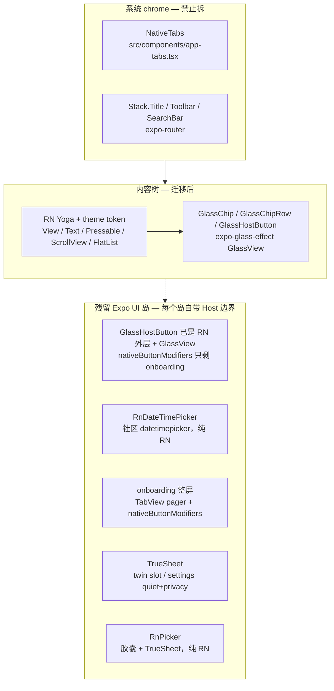
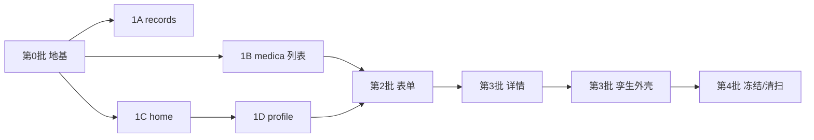

# Expo UI 内容树 → RN + expo-liquid-glass-view 迁移计划

|      |                                                                                                                                                                                                                                                 |
| ---- | ----------------------------------------------------------------------------------------------------------------------------------------------------------------------------------------------------------------------------------------------- |
| 作者 | RememberYao Expo                                                                                                                                                                                                                                |
| 日期 | 2026-10-15（2026-10-16 按实况校订）                                                                                                                                                                                                              |
| 状态 | **已完成**（第 0–3 批 + PR9.5 + PR10 + PR11 + PR13；§6 剩余事项见文末）                                                                                                                                                                                  |
| 范围 | RememberYao Expo 版（`app/`，原 `expo/` 已改名），SDK 58                                                                                                                                                                                         |
| 关联 | [`AGENTS.md`](../../AGENTS.md)、[`docs/conventions/ui-design.md`](../conventions/ui-design.md)、[`docs/conventions/expo-ui-layout.md`](../conventions/expo-ui-layout.md)、[`docs/plans/medication-digital-twin.md`](medication-digital-twin.md) |

> **读前必看**：本文是**计划 + 实施记录**。§1–§2 的代码草图与「当前状态」描述写于迁移前
> （2026-10-15），部分已被实况推翻 —— 一律以**「修订记录」**和 **§3 进度跟踪**为准，
> 代码本身为准绳。§屏幕盘点是迁移前快照，同样只作历史记录。

---

## Overview

Expo 版当初把 `@expo/ui` 当整屏画布，核心动机是 **iOS 26 液态玻璃**。本方案把内容树迁回 RN Yoga + theme token，系统 chrome（`NativeTabs`、`Stack.Title` / `Toolbar` / `SearchBar`）不动。

仓库上层已在写原生 iOS / Android，Expo 版是行为参照，不是最终交付物。迁移目标是 **降低 Expo 版维护税**（少一座 Host↔RNHostView 桥、少一次 `useExpoUiContentWidth` 测宽），按风险从低到高一屏一 PR，随时可停。禁止大爆炸重写，禁止为验收启动模拟器 / 跑 Maestro（硬规则 45）。

**已达成**：生产内容树 100% 纯 RN；`@expo/ui` 在生产屏只剩两处合法残留（`onboarding.tsx` 整屏 `TabView` pager、孪生铝箔岛 `nativeGradientBackground`）—— 5 处菜单 `Picker` 也已于 2026-10-16 换成 `RnPicker`（§6.7），`ExpoUiIsland` 生产零调用；`bun run check` 0 error / 0 warning；三个原生模块的 pod 均已进包。

---

## 修订记录（2026-10-16 校订）

计划期写死、实施后被推翻的结论，集中记在这里，正文不再逐句改写（保留原始决策语境）：

| 计划期结论 | 实况 |
| --- | --- |
| 旧 `Chip` 双轨到 PR13 之后由 **PR14** 删除（§1.3、§2 决策原则 4、§4 表、Key Decisions 6、API 表、Risks） | 实际在 **PR11** 删除：`form.tsx` 先零引用，`chip.*` 随之成链死代码，不必等 PR13 |
| `expo-glass-effect` 保持零引用，PR14 从 `package.json` 删除（Overview、Non-Goals） | **依赖保留**：`GlassHostButton` 与 `GlassChip` / `GlassChipRow` 都在用（`expo-ui-island.tsx`、`glass-chip.tsx`） |
| chip 不套融合容器、筛选行继续不套容器（§1.3） | 实况用 `expo-glass-effect` 的 `GlassContainer spacing={2}`。2pt 阈值下 chip 间距 8pt 谁也融不到谁，容器只是分组边界、不产生融合，观感与「不套」一致；PR11 把它收进 `glass-chip.tsx` 的 `GlassChipRow` |
| 内容玻璃一律走 `expo-liquid-glass-view` 的 `LiquidGlassView`（§1.2 / §1.3 草图） | chip 与玻璃按钮实际走 `expo-glass-effect` 的 `GlassView`（0.1.11 的 `LiquidGlassView` 不发类型声明，`src/types/expo-liquid-glass-view.d.ts` 是后补的 module augmentation）。`ContentGlass`（`LiquidGlassView` 封装）目前**只有 playground 在渲染，生产屏零调用**；`content-glass.tsx` 仍被 `GlassChip` 消费的是 `useLiquidGlassEnabled()` |
| `useExpoUiContentWidth` 在最后一个调用方迁完后删除（§1.5） | 已由 PR10 删除，全仓零引用 |
| **Q5：菜单 `Picker` 留最小 `ExpoUiIsland` 岛**（§1.7、allowlist、Key Decisions 18） | **2026-10-16 推翻**：5 处全换成 `RnPicker`（§6.7），`ExpoUiIsland` 随即因生产零调用被整段删除（§6.8） |
| sheet 用 `@expo/ui` 的 `BottomSheet`（§1 架构图、§1.8） | 已定选 `@lodev09/react-native-true-sheet`，2026-10-16 完成 prebuild |
| 玻璃按钮经 `nativeButtonModifiers({ style: "glass" })`（§1.9 表） | `nativeButtonModifiers` 现在**只有 onboarding 一处调用**；detail / twin / person-detail 的玻璃按钮全走 `GlassHostButton`（`expo-glass-effect` 的 `GlassView`） |
| 目录名 `expo/`（§8、References） | 仓库已改名为 `app/` |
| **Q1：settings 本阶段冻结**（§4 第 4 批、Key Decisions 14、PR12） | **2026-10-16 由开发者推翻**，设置页已迁纯 RN（PR13 / §6.6）。`FieldGroup` 全仓零调用 |
| `NativeDatePicker` 全程保留（§1.6、allowlist、Q6） | 已删除：RN 表单页与 settings 都走 `RnDateTimePicker`，这套 Expo UI 日期选择器早在设置页迁移前就零调用（PR11 漏核） |
| **Q5：表单菜单 `Picker` 留最小 `ExpoUiIsland` 岛**（§1.7、allowlist、Key Decisions 18） | **2026-10-16 推翻**：5 处全换成 `RnPicker`（灰底胶囊 + TrueSheet，§6.7），`ExpoUiIsland` 随即因生产零调用被整段删除（§6.8） |

---

### 迁移前的状态（历史快照，2026-10-15）

几乎所有生产屏都是「整屏 `Host` + 原生 `ScrollView`/`List`/`FieldGroup`，RN 只以 `RNHostView matchContents` island 嵌入」。island 拿不到父宽，于是发明了 `useExpoUiContentWidth`（窗口 fallback + `Host.onLayout` + `onLayoutContent` 三方取最小值）把数字宽度喂进牌堆、库存速览、Mini Archive、孪生网格。这套桥是本仓最大的 UI 维护税，文档见 [`expo-ui-layout.md`](../conventions/expo-ui-layout.md)。

液态玻璃当时只出现在：

- 系统 chrome：`NativeTabs`（`src/components/app-tabs.tsx`）+ 大标题 / 工具栏 / 搜索栏（expo-router，自动带 iOS 26 玻璃）。
- 内容：`src/components/chip.ios.tsx`（**PR11 已删**）的 SwiftUI `glassEffect({ glass: { variant: "regular", tint }, shape: "capsule" })`。
- 按钮：`nativeButtonModifiers({ style: "glass" | "glassProminent" })` → iOS `buttonStyle(.glass)`（Android 实现忽略 `style`，只处理 `fullWidth`）。

`package.json` 已有 `"expo-liquid-glass-view": "^0.1.11"`，当时源码零引用。`app.json` 的 `plugins` 不需要登记它——`expo-module.config.json` 只声明 apple 平台，靠 autolinking。同目录下的 `"expo-glass-effect": "~58.0.3"` 当时计划保持零引用、清扫时删除 —— **该计划已作废，依赖保留**（见修订记录）。

### 迁移后的状态（实况，2026-10-16）

| 层 | 技术 |
| --- | --- |
| 系统 chrome | `NativeTabs` / `Stack.Title` / `Toolbar` / `SearchBar`（未动） |
| 内容树 | 纯 RN Yoga + `useTheme()` + `ScreenScaffold` / `Padded` / `FullBleed` |
| 内容玻璃 | `GlassChip` / `GlassChipRow`（`glass-chip.tsx`）、`GlassHostButton`（`glass-host-button.tsx`）—— 都走 `expo-glass-effect` 的 `GlassView` |
| 残留 `@expo/ui` 岛 | `onboarding.tsx` 整屏 `TabView` pager（Q 默认不迁）、孪生铝箔岛 `nativeGradientBackground`（Q2 冻结）。**菜单 `Picker` 已清零**（2026-10-16，见 §6.7） |
| 日期选择 | 全部走 `RnDateTimePicker`（`@react-native-community/datetimepicker`）。`NativeDatePicker` 三件套已删除（设置页迁移后零调用） |

`useExpoUiContentWidth`、`RNHostView` 内容树包装、`*ExpoUI` 包装、旧 `chip.*` / `form.tsx` / `section-card.tsx` / `round-icon-button.tsx`、`useNativeState` 调用：**全部为零**。

### 痛点

1. **双布局系统**：Host 内没有 Yoga `flex`，通栏靠 `Spacer flexible`，等分靠测宽；island 要 `matchContents` 且 iOS 不转发 `RNHostView.style`。
2. **已知真机 bug**：`FieldGroup` / `List` 嵌进外层 `ScrollView` 塌成零高。详情 / 成员页已改 `SectionCard` 绕开，药品列表把 `List` 自己当滚动容器。规则靠人记。
3. **`@expo/ui` 的 `Text` 在 iOS 上不落 `testID`**（`TextView.swift` 漏调 `applyAccessibilityIdentifier`），Maestro 大量靠中文文案定位。迁到 RN `Text`/`Pressable` 后 testID 会更稳，但文案断言不能丢。
4. **上层原生重写正在进行**，Expo 版 ROI 会持续下降。批次必须可独立停、可独立 revert。

---

## Goals & Non-Goals

### Goals

- 新屏默认 RN + theme token；内容玻璃走项目内封装（`GlassChip` / `GlassHostButton` / `ContentGlass`）。
- 系统 chrome 液态玻璃完整保留。
- 按批次一屏一 PR 迁现有屏；每 PR `bun run check` 0 error / 0 warning。
- 所有现有 testID 语义不变；Maestro yaml 的定位点仍在（改脚本只在控件结构真变时）。
- 规范改完后，agent 不再把新屏写成 `Host`+`Column`+`ScrollView`。

### Non-Goals

- 不改 store / schema / 通知 / i18n 词条语义（除非随 dose-rail 删除而清死词条）。
- 不把 Expo 版做成最终交付物，不为 Android 补一套「假液态玻璃」。
- 不引入 `@callstack/liquid-glass`、`react-native-liquid-glassmorphism`、Reanimated 手搓 sheet、新日期库。sheet 用 `@lodev09/react-native-true-sheet`（2026-10 决策，替代 `@expo/ui` 的 `BottomSheet`；`@gorhom/bottom-sheet` 试过后因 JS 渲染视觉对不齐系统已卸载）。
- 不主动跑模拟器 / 真机 / Maestro（硬规则 45）。
- 本阶段不重做孪生铝箔渐变、不迁 onboarding `TabView` pager。（设置页 `FieldGroup` 原也冻结在此，2026-10-16 由开发者推翻并迁完，见 PR13 / §6.6。）

---

## Proposed Design

### 1. 目标架构



> 图中 `BottomSheet` 已换成 `@lodev09/react-native-true-sheet`（§1.8 三次迭代的定论）；
> `Button + nativeButtonModifiers` 那一路已被 `GlassHostButton` 取代（§1.9）；
> settings 的 `FieldGroup` 整屏与它的两个 sheet 已分别随 PR13 / PR10 迁走，图中只剩 onboarding 一座整屏岛。

分层规则：

| 层          | 技术                                 | 玻璃从哪来                                    | 例子                                            |
| ----------- | ------------------------------------ | --------------------------------------------- | ----------------------------------------------- |
| 系统 chrome | expo-router `NativeTabs` / `Stack.*` | 系统自动                                      | tab 栏、大标题、搜索栏、首页成员 `Toolbar.Menu` |
| 内容树      | RN Yoga + `useTheme()`               | 无                                            | 日期、列表、卡片、空态、统计                    |
| 内容玻璃    | `glass-chip.tsx` / `glass-host-button.tsx` 的 `expo-glass-effect` `GlassView` | iOS 26 `UIGlassEffect` | 筛选 chip、玻璃按钮                             |
| 残留岛      | `@expo/ui` 局部 `Host`               | 系统 Form / SwiftUI 渐变                       | 孪生铝箔、`onboarding.tsx` 整屏（菜单 `Picker` 已换 `RnPicker`，§6.7）            |

> 第三行原计划写 `expo-liquid-glass-view` 的 `LiquidGlassView`，实况改走 `expo-glass-effect`（见修订记录）。`ContentGlass`（`LiquidGlassView` 封装）保留在 `content-glass.tsx`，但目前只有 playground 渲染。

残留岛的 **Host 边界**：岛是「Expo UI 子树」，必须有自己的 `<Host>`（或落在仍是 Expo UI 的父屏里）。迁完的 RN 屏若还要玻璃按钮 / DatePicker，在 RN 树里嵌一个 **最小 `Host matchContents`**，里面只放那一个原生控件，不要把整屏再包回 Host。

### 1.1 `expo-liquid-glass-view` 真实 API（禁止臆造）

来源：已安装包 `node_modules/expo-liquid-glass-view@0.1.11` 的 `build/*.d.ts`、`ios/**/*.swift` 与 `README.md`，不是文档记忆。

**导出**（`build/root/index.d.ts`，经 `build/index.d.ts` 再导出）：

```ts
export { LiquidGlassView, LiquidGlassContainer } from "../components";
export { supportsNativeGlass } from "../utils";
export { GlassRenderer, GlassVariant } from "../enum/index";
// 类型：LiquidGlassViewProps / LiquidGlassContainerProps / GlassMetalOptions /
//       GlassCornerRadii / GlassCornerRadius / GlassVariant / GlassRenderer /
//       GlassActiveRenderer / GlassCornerStyle …
```

原生模块名 `ExpoLiquidGlass`，原生视图 `LiquidGlassView` / `LiquidGlassContainerView`（`build/constants/native.constants.ts`）。prebuild 后应在 Xcode 工程里看到 `ExpoLiquidGlass` pod——这是「原生模块真的进包了」的机械判据。

**`LiquidGlassViewProps`**（`build/interfaces/liquid-glass-view.interface.d.ts`；继承 `IGlassSurfaceProps` = `{ style?, children? }`，**不继承 `ViewProps`**）：

| prop              | 类型                                                                   | 默认             | 含义                                                                                 |
| ----------------- | ---------------------------------------------------------------------- | ---------------- | ------------------------------------------------------------------------------------ |
| `variant`         | `'regular' \| 'clear'`                                                 | `'regular'`      | 材质性格；`clear` 更薄、更少磨砂。对应今天 chip.ios 用的 `regular` 那一档             |
| `renderer`        | `'auto' \| 'native' \| 'metal'`                                        | `'auto'`         | 后端。auto = iOS 26+ 走 `UIGlassEffect`，更低系统走 Metal 自渲染                     |
| `cornerRadius`    | `number \| { topLeft?, topRight?, bottomRight?, bottomLeft? }`         | `0`              | **玻璃圆角只认这个 prop**；RN `borderRadius` 不塑形原生玻璃层（见下方原生约束）       |
| `cornerStyle`     | `'continuous' \| 'circular'`                                           | `'continuous'`   | 对应本仓 `borderCurve: "continuous"` 约定                                            |
| `tint`            | `ColorValue`                                                           | —                | 着色，**alpha 控制强度**（对应今天 chip 选中态的 `tint: theme.primary`）              |
| `interactive`     | `boolean`                                                              | `false`          | 按压时玻璃形变，仅 iOS 26 原生路径生效，Metal 路径忽略。chip.ios 注释写明筛选 chip **不要** |
| `metal`           | `IGlassMetalOptions`                                                   | —                | Metal 渲染调参（blur/frost/refraction/dispersion/highlight/border…）；原生路径忽略  |
| `containerStyle`  | `StyleProp<ViewStyle>`                                                 | —                | children 外包一层的样式                                                              |
| `onRendererChange`| `(renderer: 'native' \| 'metal' \| 'fallback-blur') => void`           | —                | 回读设备实际走了哪条渲染路径                                                         |
| `style`/`children`| RN 标准                                                                | —                | `style` 给原生玻璃视图；children 由 JS 包进 `<View pointerEvents="box-none">`        |

**`LiquidGlassContainerProps`**：`spacing?: number`（玻璃元件开始互相融合的距离）+ `IGlassSurfaceProps`。chip.ios 已明确 **不套融合容器**（chip 间距 8pt，融不到一起，融合还会抢戏）。筛选行继续不套 `LiquidGlassContainer`。

**可用性**（与 `expo-glass-effect` 完全不同：没有 `isGlassEffectAPIAvailable()` / `isLiquidGlassAvailable()` 两个函数）：

- `supportsNativeGlass`：import 时求值一次的布尔 = `Platform.OS === "ios" && ExpoLiquidGlassModule?.supportsNativeGlass === true`；原生侧只是 `#available(iOS 26.0, *)` 判断，**不**表示用户没开「降低透明度」。降透明仍要 `AccessibilityInfo.isReduceTransparencyEnabled()`。
- 视图自己还会再探一次 `UIGlassEffect` 类（`NSClassFromString` + `responds(to: effectWithStyle:)`，`ios/Views/LiquidGlassView.swift`）。iOS 26 上类缺失（[expo#40911](https://github.com/expo/expo/issues/40911) 那类 API 空洞）时，按「Metal 可用 → `metal`；Metal 也不可用 → `fallback-blur`（`UIBlurEffect(style: .systemThinMaterial)`）」退化，并通过 `onRendererChange` 报出来。**这是包自带的兜底，不是我们要写的代码**；本仓正常只会见到 `"native"`。
- iOS 16.4–25 走 Metal 自渲染。本仓 `ios.deploymentTarget` 已是 `"26.0"`，Metal 分支实际不可达，`renderer` 保持默认 `"auto"` 即可，不传。
- **Android / web 没有平台兜底文件**（`build/` 下无 `.android.*` / `.web.*`）。`requireOptionalNativeModule` 返回 null 让 `supportsNativeGlass` 安全地为 false，但 `LiquidGlassView` 一渲染就是未注册的原生 host 组件。包 README 声称 "On Android and web the components render as plain views"，0.1.11 的编译产物里并没有这个分支——所以 `ContentGlass` 必须**在非 iOS 根本不渲染 `LiquidGlassView`**（§1.2 的 `useLiquidGlassEnabled` 正是这么设计的），不能依赖包兜底。这是与 `expo-glass-effect`（自带 `.ts` 退化成 `View`）最大的行为差异。

**原生侧约束**（`ios/Views/LiquidGlassView.swift`）：玻璃效果在 `didMoveToWindow`（进入 window）+ 首次 `layoutSubviews` 时安装；挂在 window 外只是延后，不会永久跳过（`expo-glass-effect` 那套「静默跳过且以后不再安装」的逻辑本包没有）。`onRendererChange` 同样要求 `window != nil`。圆角/mask 由 `cornerRadius` prop 驱动（`cornerRadii` → `visualEffectView.layer.mask` 与 contentContainer），RN 样式里的 `borderRadius` 落在 `NonRenderableLayer` 上，对玻璃形状无效。仍然**不要给玻璃祖先设接近 0 的 opacity**：视觉上直接变淡，Metal 路径的采样也会一起淡。

本仓 `app.json` 的 `ios.deploymentTarget` 已是 `"26.0"`，iOS 发行面理论上都是 26；fallback 仍然要做，因为：(a) Android（不渲染原生组件）；(b) 降低透明度（`AccessibilityInfo`）；(c) iOS 26 上 `UIGlassEffect` 类缺失（包内退化，我们只用 `onRendererChange` 观察）。

### 1.2 项目封装：`ContentGlass` + `canUseLiquidGlass`

新建 `src/components/content-glass.tsx`。**不要**让屏幕直接 import `expo-liquid-glass-view`。

```tsx
import {
  AccessibilityInfo,
  View as RNView,
  type StyleProp,
  type ViewStyle,
} from "react-native";
import {
  LiquidGlassView,
  supportsNativeGlass,
  type GlassVariant,
} from "expo-liquid-glass-view";
import { useEffect, useState } from "react";

/**
 * 编译期组件 + 运行时 API 都在。降透明是另一条状态，不进这个函数。
 * `supportsNativeGlass` 是 import 时求值一次的常量（iOS 26+ OS 判断），
 * 不需要像 expo-glass-effect 那样再套 module cache。
 */
export function canUseLiquidGlassSync(): boolean {
  return process.env.EXPO_OS === "ios" && supportsNativeGlass;
}

/**
 * ContentGlass 与 GlassChip 共用：a11y 未 resolve 时必须是 false，
 * 这样首帧走实心 fallback，不会闪一帧玻璃。
 */
export function useLiquidGlassEnabled(): boolean {
  const [reduceTransparency, setReduceTransparency] = useState<boolean | null>(
    null,
  );
  useEffect(() => {
    let alive = true;
    void AccessibilityInfo.isReduceTransparencyEnabled().then((v) => {
      if (alive) setReduceTransparency(!!v);
    });
    const sub = AccessibilityInfo.addEventListener(
      "reduceTransparencyChanged",
      setReduceTransparency,
    );
    return () => {
      alive = false;
      sub.remove();
    };
  }, []);
  return reduceTransparency === false && canUseLiquidGlassSync();
}

/**
 * 注意：`LiquidGlassViewProps` 只继承 `{ style, children }` + 玻璃 props，
 * **不继承 ViewProps** —— testID / pointerEvents / onLayout 不能透传给它，
 * 所以这里显式列 props，不做 `...rest` 转发。RN 语义（testID、手势）
 * 一律由调用方写在外层 Pressable / View 上。
 */
export function ContentGlass({
  children,
  tint,
  variant = "regular",
  cornerRadius = 0,
  interactive = false,
  fallbackStyle,
  style,
}: {
  children?: React.ReactNode;
  /** 着色；alpha 控制强度 */
  tint?: string;
  variant?: GlassVariant;
  /** 玻璃圆角只认这个 prop，RN borderRadius 不塑形原生玻璃层 */
  cornerRadius?: number;
  interactive?: boolean;
  /** API 不可用 / 降透明 / Android / a11y 未 resolve：普通 View 的底 */
  fallbackStyle?: StyleProp<ViewStyle>;
  style?: StyleProp<ViewStyle>;
}) {
  const native = useLiquidGlassEnabled();

  if (!native) {
    return <RNView style={[fallbackStyle, style]}>{children}</RNView>;
  }
  return (
    <LiquidGlassView
      variant={variant}
      tint={tint}
      cornerRadius={cornerRadius}
      cornerStyle="continuous"
      interactive={interactive}
      // 新包没有 colorScheme prop：frost 取 UIColor.systemBackground 并按
      // traitCollection 解析，暗色自动翻面，跟随系统外观即可。
      style={style}
    >
      {children}
    </LiquidGlassView>
  );
}
```

**Android / web 策略**：`ContentGlass` 在非 iOS 上就是带 `fallbackStyle` 的 `View`——而且**必须**在非 iOS 根本不渲染 `LiquidGlassView`（该包没有平台兜底文件，渲染即撞未注册原生组件）。`canUseLiquidGlassSync()` 的 `EXPO_OS === "ios"` 门就是干这个的。chip 的选中态 **绝不能** 依赖玻璃 tint——否则 Android 变成透明空壳。见 §1.3。

**不要**用 `expo-blur` 的 `BlurView` 冒充液态玻璃（牌堆 / Mini Archive 已经在用 BlurView 做卡片材质，那是另一件事）。内容玻璃的 fallback 是 theme token 的实心 / 半透明底，观感允许比 iOS 26 玻璃「扁」，但不允许不可点、不可见。

**没有 `colorScheme` 可传。** `expo-glass-effect` 的 `colorScheme` prop 在新包里不存在；原生侧 `resolvedFrostColor` 用 `UIColor.systemBackground.resolvedColor(with: traitCollection)`，暗色自动翻面。封装层不从 `useColorScheme` 注入任何东西。

### 1.3 RN `GlassChip`

迁移前的三份 `Chip` 实现（`chip.ios.tsx` / `chip.android.tsx` / `chip.tsx`）与它们的调用方清单，已随 PR11 全部删除 / 切换，此处仅作历史记录：

- iOS：`chip.ios.tsx`，`Row` + `glassEffect({ glass: active ? { variant: "regular", tint: theme.primary } : { variant: "regular" }, shape: "capsule" })`，文字 `onGlassChipActive` / `onGlassChipInactive`。
- Android：`chip.android.tsx`，Compose `FilterChip`（`@expo/ui/jetpack-compose`），选中品牌色实心 + 描边同色，testID 走 `Modifier.applyTestTag`。**FilterChip 离开 `Host` 会丢 view config**，不能进 Yoga 内容树 —— 这是 `GlassChip` 必须另写一份 RN 实现、不得 reuse 的原因。
- web 兜底：`chip.tsx`，几乎无底的 `Row`。

旧 `Chip` 的三个真实调用方：`filter-row.tsx`（1B）、`form.tsx` 的 `ChipField` + `medica/form.tsx` 处方 Chip（第 2 批）、`twin.tsx` 的 `twin-pack-<seq>`（第 3 批）。

热区：`Pressable` 必须做最外层，padding 写在 `Pressable` 上，玻璃层只负责铺底（被 Pressable 撑开）。不要给玻璃层 `overflow: "hidden"`，以免糊掉高光。iOS 与 Android 都要 `accessibilityRole="button"` 和 `accessibilityState={{ selected: active }}`。

下面的草图写于第 0 批，**与最终实现的差异**：最终没有走 `ContentGlass`，而是直接用 `expo-glass-effect` 的 `GlassView`（见修订记录）；圆角用 `Radius.pill` 而非 `999`；实心 fallback 分支不带 `borderWidth`。

```tsx
// src/components/glass-chip.tsx — 草图（已被实况取代，仅存设计意图）
export function GlassChip({
  testID,
  label,
  active,
  onPress,
}: {
  testID?: string;
  label: string;
  active: boolean;
  onPress?: () => void;
}) {
  const theme = useTheme();
  // 必须与 ContentGlass 同一信号：a11y 未 resolve / 降透明 / 非 iOS 都是 false。
  // 禁止只用 canUseLiquidGlassSync()——那会在首帧把 onGlassChip* 印到实心底上。
  const nativeGlass = useLiquidGlassEnabled();
  // 玻璃开启：印刷色不随暗色翻面（叠在 canvas 上的透明玻璃）。
  // 实心 fallback（API 不可用 / 降透明 / Android）：与 Android 相同的 token，
  // 禁止把 onGlassChipInactive（#000）铺到暗色 surface（#1C1C1E）上。
  const labelColor = nativeGlass
    ? active
      ? theme.onGlassChipActive
      : theme.onGlassChipInactive
    : active
      ? theme.onPrimary
      : theme.textSecondary;

  return (
    <Pressable
      testID={testID}
      onPress={onPress}
      accessibilityRole="button"
      accessibilityState={{ selected: active }}
      style={({ pressed }) => ({
        paddingHorizontal: Spacing.three,
        paddingVertical: Spacing.two,
        minHeight: 32,
        borderRadius: 999,
        borderCurve: "continuous",
        // 玻璃祖先禁止改 opacity：opacity 过低玻璃会直接变淡，
        // Metal 路径的采样会一起淡。Android 实心分支可以。
        ...(!nativeGlass && pressed ? { opacity: 0.85 } : null),
        ...(nativeGlass
          ? null
          : {
              backgroundColor: active ? theme.primary : theme.surface,
              borderWidth: 1,
              borderColor: active ? theme.primary : theme.border,
            }),
      })}
    >
      {nativeGlass ? (
        <ContentGlass
          variant="regular"
          tint={active ? theme.primary : undefined}
          interactive={false}
          // 玻璃圆角只认 cornerRadius prop（原生侧会 clamp 成胶囊）；
          // style.borderRadius 落在非渲染层上，对玻璃形状无效。
          cornerRadius={999}
          // 铺满 Pressable 的边框盒（含 padding），玻璃才是整颗胶囊。
          // 禁止 overflow: 'hidden'（会糊掉高光）。
          style={{
            position: "absolute",
            top: 0,
            right: 0,
            bottom: 0,
            left: 0,
          }}
          fallbackStyle={{
            backgroundColor: active ? theme.primary : theme.surface,
            borderWidth: 1,
            borderColor: active ? theme.primary : theme.border,
          }}
        />
      ) : null}
      <RNText style={{ fontSize: 14, fontWeight: "600", color: labelColor }}>
        {label}
      </RNText>
    </Pressable>
  );
}
```

实现注意：padding 只出现在 `Pressable` 上，热区 = 整颗胶囊。`ContentGlass` 绝对定位铺底、不抢手势（命中玻璃层时事件沿祖先链回到 Pressable）。`nativeGlass` 与 `ContentGlass` 共用 `useLiquidGlassEnabled()`，首帧 / 降透明 / Android 都走实心 token，印刷色不会印到错底上。`fallbackStyle` 只在 `nativeGlass === true` 却仍走 RN View 的极端路径生效（理论上不会，因为同一 hook）。胶囊圆角：iOS 玻璃路径靠 `cornerRadius={999}` prop，fallback / Android 路径靠 Pressable 自己的 `borderRadius: 999`——两处都要写，缺一不可。

Android 这一支是 **有选中态的实心胶囊**（对齐 design/medications.html `.chip` / `.chip.active`），不是透明玻璃，也 **不是** 包在 Host 里的官方 `FilterChip`。按压用 `opacity`，不引入 Reanimated。系统大字号靠 `minHeight: 32` + padding，允许被动态字体撑高。

### 1.4 `ScreenScaffold`

新建 `src/components/screen-scaffold.tsx`。chrome 仍由屏幕自己声明 `Stack.Title` / `Toolbar` / `SearchBar`（硬规则 13），本组件只包内容树。

**默认不要水平 padding。** `src/screens/profile/index.tsx` 明确 Mini Archive「不跟着其它区块内缩」、通栏横滑；`WeekOverview` / 成员区自己带 `paddingHorizontal: Spacing.screen`。Scaffold 若一律 `paddingHorizontal: Spacing.screen`（20），档案横滑会少 40pt，和 `design/profile.html` 以及 `maestro/profile.yaml` 的 `x=90%` 滑动假设都偏。

```tsx
export function ScreenScaffold({
  children,
  scroll = true,
  contentContainerStyle,
}: {
  children: React.ReactNode;
  scroll?: boolean;
  contentContainerStyle?: object;
}) {
  const theme = useTheme();
  const style = { flex: 1, backgroundColor: theme.canvas } as const;
  return (
    <RNScrollView
      style={style}
      // scroll={false} 不是换成 RNView，而是关掉滚动的 ScrollView ——
      // FlatList 需要「已确定高度的非滚动父级」才不会重新测量
      scrollEnabled={scroll}
      contentContainerStyle={[
        {
          paddingTop: Spacing.three,
          paddingBottom: BottomTabInset + Spacing.five,
          // 故意没有 paddingHorizontal
        },
        contentContainerStyle,
      ]}
      contentInsetAdjustmentBehavior="automatic"
      keyboardShouldPersistTaps="handled"
      showsVerticalScrollIndicator={false}
    >
      {children}
    </RNScrollView>
  );
}

/** 内缩一档：home / records / 表单的常规区块 */
export function Padded({ children }: { children: React.ReactNode }) {
  return (
    <RNView style={{ paddingHorizontal: Spacing.screen }}>{children}</RNView>
  );
}

/** 通栏：profile Mini Archive。必须顶到屏幕左右缘。 */
export function FullBleed({ children }: { children: React.ReactNode }) {
  return <RNView style={{ alignSelf: "stretch" }}>{children}</RNView>;
}
```

用法：profile = `ScreenScaffold` 里 `FullBleed`（Archive）+ `Padded`（统计 / 成员）；home / records 整页包一层 `Padded`（或自己写 `paddingHorizontal`）。列表屏（药品库）`scroll={false}`，自己用 `FlatList`（硬规则 10）；FilterRow 的左右呼吸仍挂在横滑内容的 `paddingHorizontal: Spacing.screen` 上（今日 `filter-row.tsx` 已是这个写法，滚动时跟着内容走）。

表单屏沿用 `keyboardShouldPersistTaps="handled"`（硬规则 42）。

对照：`src/app/(tabs)/playground/index.tsx` 是纯 RN，但安全区/底色自己算，**不是**本 Scaffold 的复制对象。迁完的生产 tab 屏用 Scaffold + `theme.canvas`。

### 1.5 宽度：拆掉 `useExpoUiContentWidth`

`src/hooks/use-expo-ui-content-width.ts`（**PR10 已删**）的唯一理由是「matchContents 下 RN 自测拿不到 Host 父宽」。内容树变成 RN 之后：

- 牌堆 / 库存 / Mini Archive 用父级 `onLayout` 或直接 `width: '100%'` + Yoga `flex`。
- `ReminderCardStack` 已有降级：`containerWidth ?? (hostWidth || windowWidth - Spacing.three * 2)`。迁完首页后 **停传 `containerWidth`**，让它走内部 `onLayout`。
- `StockPanel` 今日 `width: containerWidth` 是因为药名 `flex: 1` 在不定宽父级会塌成 0。RN 父级有明确宽度后改 `alignSelf: 'stretch'`，删 prop。
- 三等分统计卡（profile）改 `flex: 1`，删「按实测内容宽度算卡宽」。
- 孪生网格等分仍要数字宽度（格子 `CELL_MIN`/`CELL_MAX`），用格子父级 `onLayout`，不测 Host。

`useExpoUiContentWidth` 在最后一个调用方（预计孪生，批 3/4）迁完后删除。在此之前保留，供未迁屏使用。

**已拆除（PR10）**：孪生页迁完后 `use-expo-ui-content-width.ts` 已删除，全仓零引用。

### 1.6 Avatar / ProgressBar / Icon

迁移前的三份头像实现与两种进度条，已随 PR11 收敛；下表「今日」列是历史快照：

| 组件           | 迁移前                                                           | 迁移后                                                                                                                                                                              |
| -------------- | ---------------------------------------------------------------- | ----------------------------------------------------------------------------------------------------------------------------------------------------------------------------------- |
| `AvatarMark`   | 已是纯 RN                                                        | **唯一保留**。全部 7 个调用方直接用它                                                                                                                                                 |
| `Avatar`       | `RNHostView` 包 `AvatarMark`                                     | **已删（PR11）**                                                                                                                                                                    |
| `MemberAvatar` | 无照片 = Expo UI `Row`+`Text`；有照片 = `RNHostView matchContents` | **已删（PR11）**                                                                                                                                                                    |
| `ProgressBar`  | `RNHostView` + RN 轨道                                           | **已删（PR11）**。只剩 `ProgressBarRn`，records / detail / twin 三处全用它                                                                                                            |
| 内容图标       | `@expo/ui` `Icon` + `ICONS`（`src/components/icons.ts`）           | `SymbolIcon` + `SYMBOL_ICONS`（`src/components/symbol-icon.tsx` / `expo-symbols`）。`ICONS` 只剩 twin 铝箔岛在用；settings / stock-panel 已切 `SYMBOL_ICONS`                                            |
| 工具栏图标     | `toolbar-icons.ts`                                               | **不迁**。`Stack.Toolbar` 只认 SF Symbol / 图片源                                                                                                                                     |

`round-icon-button.tsx` 迁移前是 Expo UI `Row`+`Icon`；RN 版 `rn-round-icon-button.tsx`（`Pressable` + `SymbolIcon` + `borderCurve: "continuous"`）已接管，旧文件 **PR11 删除**；testID `profile-add-member-button` 不变。

`ProgressBar` 调用方经源码确认有三处：`records.tsx`、`medica/detail.tsx`、`twin.tsx`。迁移前默认导出是 `RNHostView style={{ width: "100%", height }}` 包 RN 轨道；PR1 若直接删掉 `RNHostView` **不会编译失败**，会在仍是 `Host`+`Column` 的详情/孪生里把宽度塌掉。这就是当年「完成定义是 Expo UI 调用方仍走包装」的原因 —— 该包装现已随 PR11 删除。

### 1.7 `ExpoUiIsland`：残留岛的唯一 Host 边界（⚠️ 整节已作废，2026-10-16 删除）

第 0 批新建 `src/components/expo-ui-island.tsx`。RN 父树里要挂任何 `@expo/ui` 原生视图，必须走这一层，禁止各屏手写 Host。

**删除原因（§6.8）**：它的唯一生产用途是包菜单 `Picker`；5 处 Picker 换成 `RnPicker`（§6.7）后
`ExpoUiIsland` 生产零调用。一个「鼓励往 RN 树里塞 `Host`」的封装在生产零调用比留着更危险，
所以整段删除，`GlassHostButton` 拆去独立的 `glass-host-button.tsx`。

```tsx
import { Host } from "@expo/ui";
import { useTheme } from "@/hooks/use-theme";

/** RN Yoga 树里的最小 Expo UI 岛。只收 Expo UI 子树，不要往里塞 RN 组件。 */
export function ExpoUiIsland({ children }: { children: React.ReactNode }) {
  const theme = useTheme();
  return (
    <Host seedColor={theme.primary} matchContents>
      {children}
    </Host>
  );
}
```

约定：

- `matchContents`：岛的尺寸来自原生子树固有尺寸（按钮、compact DatePicker、菜单 Picker）。
- `seedColor={theme.primary}`：原生 tint 跟品牌色。
- 岛内禁止再放 `RNHostView` / RN `View`（那是反向桥，正是 DatePicker 历史坑）。

**`ExpoUiIsland` 的最终归属（2026-10-16）**：原计划承接「RN 父树里的菜单 `Picker` 小岛」，
但 5 处 Picker 已全部换成 `RnPicker`（§6.7），`ExpoUiIsland` 自此**生产零调用**，
playground 的那段演示也一并删掉。整个导出与 `Host` import 在 §6.8 移除，
`GlassHostButton` 拆去 `src/components/glass-host-button.tsx`（它本来就不需要 `ExpoUiIsland`
包裹，见本节末尾）。

**日期选择器的最终归属**：`native-date-picker.{ts,ios.tsx,android.tsx}` 三件套**已删除**。

- 迁移前 iOS 侧的 `native-date-picker.ios.tsx` **不带 Host**：注释明确反对社区组件那种 `Host matchContents`——那是 **Expo UI 父树里嵌 RN 岛** 的坑（plan-form 真机「对不齐」）。
- RN 表单页（Q6）与 settings 最终都走 `@react-native-community/datetimepicker`，封装为 `RnDateTimePicker`；`NativeDatePicker` 从此零调用。
- `embedInHost` prop 自出生起就是零调用，PR11 删掉；整套文件在设置页迁移时（2026-10-16）确认零调用后删除。

**`GlassHostButton`**（第 3 批起被 detail / person-detail / twin 使用；2026-10-16 起住独立的 `glass-host-button.tsx`）：

下面这份草图写于第 0 批（`@expo/ui` 的 `Button` + `nativeButtonModifiers`）。**实况已改**：最终实现不用 Expo UI `Button`，而是 RN `Pressable` 外层 + `expo-glass-effect` 的 `GlassView` 内层，因此**不再需要 `ExpoUiIsland`**；`style` prop 删除，新增 `tintColor` / `labelColor`（detail 的删除按钮要只染文字红、不染玻璃）。

```tsx
// 最终实现（2026-10-16 起在 src/components/glass-host-button.tsx）
export function GlassHostButton({
  testID,
  label,
  onPress,
  fullWidth,
  tintColor,
  labelColor,
}: {
  testID: string;
  label: string;
  onPress: () => void;
  fullWidth?: boolean;
  tintColor?: string | null;
  labelColor?: string | null;
}) {
  const theme = useTheme();
  return (
    <Pressable testID={testID} onPress={onPress} style={…}>
      <GlassView isInteractive {...(tintColor != null ? { tintColor } : {})} style={…}>
        <Text style={{ color: labelColor ?? theme.onPrimary, … }}>{label}</Text>
      </GlassView>
    </Pressable>
  );
}
```

iOS 走 `UIGlassEffect`，Android 的 `expo-glass-effect` 没有平台文件、退化成普通 `View`（实心主按钮由 theme token 出）。

`ExpoUiIsland` 本身是第 0 批必做（后于 §6.8 删除）；`GlassHostButton` 这个薄包装当初与它同文件，避免第 3 批再发明边界，现在独占 `glass-host-button.tsx`。

### 1.8 BottomSheet 决策

孪生格子 sheet（`twin-slot-sheet`）和设置页免打扰 / 隐私 sheet 已改用 `@lodev09/react-native-true-sheet`（2026-10 决策）。它是**真原生 sheet**（iOS `UISheetPresentationController` / Android `ModalBottomSheet`，Fabric 原生实现），视觉即系统观感；`detents={['auto']}` 内容自适应，命令式 `present(index)` / `dismiss()`。**v4 已无 `index` prop，初始关闭用 `initialDetentIndex={-1}`**；关闭回调是 `onDidDismiss`。

弃用路径记录：`@expo/ui` 根 `BottomSheet` 必须做 `FieldGroup` 子节点（同级挂 Host 会让整屏手势失效）→ `@expo/ui/community/bottom-sheet` 的 **default export 是默认挂载即打开的 `BottomSheet`**（`BottomSheetModal` 只是 named export，误用 default import 会让 sheet 一进页面就弹出）→ `@gorhom/bottom-sheet` 是 JS 渲染，背景 / 圆角 / grabber 全靠 props 拼，视觉对不齐系统。RN `Modal` 是居中对话框，不是 iOS 系统 sheet，不用。

**迁移前的方案选择（已被 `@lodev09/react-native-true-sheet` 取代，保留是为了记录「为什么当初不直接换」）**：那时打算让 `BottomSheet` 留在残留 Expo UI 岛，并保持与能工作的树同构 —— `twin.tsx` 里 sheet 是 `Host` 的兄弟（`</Host>` 之后、屏幕 fragment 根上），`settings.tsx:291` 里 sheet 必须作为 `FieldGroup` 的子节点（同级挂 Host 会让整屏手势失效）。

**实况**：孪生与设置的 sheet 都已换成 `@lodev09/react-native-true-sheet`。因为它是纯 RN 组件、不依赖 `Host`，「必须是 `FieldGroup` 子节点 / Host 兄弟」这套约束**自动失效**；settings 的两个 sheet 还进一步移到了屏幕根（Host 外），内容从 Expo UI 子树改成纯 RN（见 §5 PR10 记录）。

### 1.9 玻璃按钮

`nativeButtonModifiers({ style: "glass" | "glassProminent" })` 只在 iOS 生效（`native-layout.ios.tsx` 的 `buttonStyle`；Android 忽略 `style`）。

**实况：`nativeButtonModifiers` 现在只剩 onboarding 一处调用**，全仓 `useNativeState` 已零调用。其余按钮全部走 RN `Pressable` 或 `GlassHostButton`：

| 位置 | 实现 | testID |
| --- | --- | --- |
| `onboarding.tsx` 下一步 | Expo UI `Button` + `nativeButtonModifiers({ style: "glassProminent" })` | `onboarding-next-button` |
| `detail.tsx` 补货提交 ×2 | `GlassHostButton` | `restock-packs-submit-button` / `restock-submit-button` |
| `detail.tsx` 添加计划 | `GlassHostButton` | `medication-add-plan-button` |
| `detail.tsx` 删除 | `GlassHostButton`（`labelColor` 染红，不染玻璃） | `medication-delete-button` |
| `twin.tsx` 加板 ×2 | `GlassHostButton` | `twin-add-pack-button` |
| `person-detail.tsx` | `GlassHostButton` | `plan-add-button` / `person-edit-button` / `person-delete-button` |
| 各表单主按钮 | RN `Pressable` | `*-save-button` 等 |

> 计划期写的是「玻璃补货按钮用 `ExpoUiIsland` + `Button` + `nativeButtonModifiers`，默认保留 SwiftUI `.buttonStyle(.glass)`」。实况在第 3 批前后改成了 `GlassHostButton`（RN `Pressable` + `expo-glass-effect` 的 `GlassView`），不再需要 `ExpoUiIsland` —— 见修订记录与 §1.7。

---

## 屏幕盘点（迁移前快照，2026-10-15）

> ⚠️ **本节整块都是迁移前的历史快照**，「当前形态 / 建议处置 / 工作量」列描述的是 2026-10-15
> 动手前的状态，**不是今天的代码**。要看今天的样子，直接看 §「迁移后的状态」表与 §3 进度跟踪。
> 保留它是为了记录「当初为什么按 records → medica → home → profile 这个顺序动手」。
> `src/screens/home/dose-rail.tsx` 一行对应的文件已删除（PR6）。

| 路径 | 迁移前形态 | 迁移前 Expo UI 依赖 | 建议处置 |
| --- | --- | --- | --- |
| `src/app/(tabs)/playground/index.tsx` | 纯 RN | 无 | 不迁 |
| `src/app/records.tsx` | 纯 Expo UI | Host, Column, Row, ScrollView, Spacer, Text + `ProgressBar`（RNHostView） | 第 1 批立即迁 |
| `src/screens/medica/index.tsx` + `filter-row.tsx` | 纯 Expo UI | Host, Column, List, ListItem, Row, ScrollView(horizontal), Text, Icon, Button | 第 1 批立即迁 |
| `src/screens/home/index.tsx` + `stock-panel.tsx` | 混合：Host 外壳 + 2 island | 同上 + `nativeButtonModifiers`；宽度靠 `useExpoUiContentWidth` | 第 1 批立即迁 |
| `src/screens/profile/index.tsx` | 混合：Host 外壳 + Mini Archive island | Host, Column, Row, ScrollView, Spacer, Text, ListItem | 第 1 批立即迁 |
| `app/(tabs)/medica/form.tsx` | 纯 Expo UI 表单 | 同上 + TextInput, Button, `useNativeState`, Chip, ChipField | 第 2 批 |
| `app/(tabs)/medica/quick-add.tsx` | 纯 Expo UI 表单 | 同上 + MemberAvatar | 第 2 批 |
| `app/(tabs)/profile/persons.tsx` | 纯 Expo UI 表单 | 同上 + ChipField | 第 2 批 |
| `app/(tabs)/profile/plan-form.tsx` | 纯 Expo UI 表单 | 同上 + Checkbox, Picker | 第 2 批 |
| `app/(tabs)/medica/detail.tsx` | 纯 Expo UI | 同上 + Icon, ListItem, SectionCard | 第 3 批 |
| `app/(tabs)/profile/person-detail.tsx` | 纯 Expo UI | 同上 + Button, FormSection | 第 3 批 |
| `src/screens/medica/twin.tsx` | 混合 | 同上 + BottomSheet, Chip, `nativeGradientBackground`, `nativeContinuousShape` | 第 3 批迁外壳；铝箔冻结 |
| `src/screens/profile/settings.tsx` | 纯 Expo UI Form | Host, FieldGroup, Switch, Picker, BottomSheet, Icon | 第 4 批冻结（后由开发者推翻，见 §6.6） |
| `src/app/onboarding.tsx` | 纯 Expo UI | 同上 + `NativeOnboardingPager` | 第 4 批可选，默认不迁 |
| `src/screens/home/dose-rail.tsx` | 纯 RN，无人引用 | 仅 `RNHostView` 包装导出 | 删除（PR6 已执行） |

### 共享组件（迁移前 → 迁移后）

| 组件 | 迁移前 | 迁移后 |
| --- | --- | --- |
| `chip.tsx` / `.ios` / `.android` | Expo UI 玻璃 / Compose `FilterChip` | **已删（PR11）**，由 `glass-chip.tsx` 的 `GlassChip` 取代 |
| `section-card.tsx` | Expo UI Column/Row/Text | **已删（PR11）**，由 `rn-section-card.tsx` 取代 |
| `form.tsx` / `input-shell.tsx` | Expo UI + Chip + `roundedBox` modifiers | **已删（PR11）**，由 `rn-form.tsx` / `rn-input-shell.tsx` 取代 |
| `avatar.tsx` | 三份（`AvatarMark` / `Avatar` / `MemberAvatar`） | 只剩 `AvatarMark` |
| `progress-bar.tsx` | 默认导出是 `RNHostView` 包装 | 只剩 `ProgressBarRn` |
| `round-icon-button.tsx` | Expo UI | **已删（PR11）**，由 `rn-round-icon-button.tsx` 取代 |
| `mini-archive.tsx` | 纯 RN + `MiniArchiveExpoUI` 包装 | 纯 RN，包装已删 |
| `reminder-card-stack.tsx` | 纯 RN + `ReminderCardStackExpoUI` 包装 | 纯 RN，包装已删，宽度走 `onLayout` |
| `native-date-picker*` | 保留 Expo UI | **已删**（设置页迁移后零调用） |
| `native-layout*` | modifier 工厂 | 保留：铝箔 / pager / `nativeButtonModifiers`（仅 onboarding） |
| `use-expo-ui-content-width.ts` | Host 测宽 | **已删（PR10）** |
| `icons.ts` / `symbol-icon.tsx` | 双套图标 | 双套仍在：`ICONS`（`@expo/ui` `Icon`）只剩 twin 铝箔岛用，`SYMBOL_ICONS` 供 settings / stock-panel 等纯 RN 屏的 `SymbolIcon` 用 |
| `dose-timeline.tsx` | Expo UI，仅 records 用 | 已改纯 RN（PR2） |
| `rounded-box.tsx` | 产出 SwiftUI strokeBorder modifiers | 保留，只服务孪生铝箔岛 |
| `content-glass.tsx` / `glass-chip.tsx` / `screen-scaffold.tsx` / `glass-host-button.tsx` | 第 0 批新建 | `ContentGlass` 目前只有 playground 渲染；其余三个是生产主力（`expo-ui-island.tsx` 已删，§6.8） |

---

## 2. 迁移顺序

### 决策原则（套到本仓之后）

1. **先拆「Host 只是外壳、里面已经是 RN island」的屏** —— 去掉 Host 立刻少一次测宽。home / profile 是典型。
2. **先迁不依赖玻璃按钮 / DatePicker / FieldGroup 的屏** —— 少残留岛。
3. **先迁有 Maestro 覆盖的屏** —— 行为有回归网（脚本改 testID，但 agent 不跑）。
4. **Chip 的 RN 版不能单独替换导出** —— 必须和第 1 批 medica 列表一起第一次落地；表单继续用旧 Chip 直到第 2 批；twin pack chip 用到 PR13。旧文件 PR14 才删。
5. **后迁视觉绑死 SwiftUI modifier 的屏** —— 孪生 `nativeGradientBackground`、onboarding `TabView`、settings `FieldGroup`。
6. **playground 标完成**；**dose-rail 已删除（PR6 完成）**。

### 为什么第 1 批是这四个，而不是 onboarding / twin / settings / plan-form

读完代码后的第 1 批（立即开始）：

1. **`records`**（`src/app/records.tsx`）
2. **药品库列表**（`src/screens/medica/index.tsx` + `filter-row.tsx`）
3. **首页**（`src/screens/home/index.tsx` + `stock-panel.tsx`）
4. **「我的」首页**（`src/screens/profile/index.tsx`）

| 屏          | 为什么先                                                                                                                                                                                     | 为什么排这个相对顺序                      |
| ----------- | -------------------------------------------------------------------------------------------------------------------------------------------------------------------------------------------- | ----------------------------------------- |
| records     | 无 Maestro、无入口、UI 未完成，炸了不影响主路径；逼出 `ScreenScaffold` + 追加 `ProgressBarRn`（默认 `ProgressBar` 仍带 `RNHostView`，detail/twin 不改）+ 把唯一消费者 `DoseTimeline` 写成 RN | 第 1 个 PR 当样板                         |
| medica 列表 | `GlassChip` 的第一个真实消费者；有 `maestro/medica.yaml`；List→FlatList 是内容树迁走原生 List 的样板；不依赖 DatePicker / FieldGroup / 玻璃按钮                                              | 第 0 批 Chip 必须在某屏落地，否则永远双轨 |
| home        | 最大 island 税：牌堆 + 库存都靠 `useExpoUiContentWidth`；去掉 Host 后 `flex` 和 `onLayout` 直接工作；`dashboard.yaml` 覆盖空态和 tab 往返                                                    | 样板和 Chip 稳定后再动主落点              |
| profile     | 同样是 Host 外壳 + Mini Archive island；三等分卡靠测宽，RN 后改 flex；`profile.yaml` 覆盖添加成员入口                                                                                        | 与 home 同构，home 过了再复制             |

**不先迁 onboarding**：所有 Maestro 的第一段、冷启动分流都依赖它；`NativeOnboardingPager` 是 iOS `TabView` + Android `HorizontalPager` 的平台拆分，玻璃主按钮是 `glassProminent`。炸引导页 = 全仓不可用。放第 4 批。

**不先迁 twin**：`nativeGradientBackground` 铝箔、等分网格、`BottomSheet`、玻璃加板按钮、`maestro/twin.yaml` 从未跑、真机未验证。LiquidGlassView **替代不了**径向金属渐变。外壳可在第 3 批迁，铝箔冻结。

**不先迁 settings**：`FieldGroup` 是「SwiftUI Form 当整屏滚动容器」的唯一正确用法，再套 ScrollView 会零高。本阶段冻结。

**不先迁 plan-form / 其它表单**：`Picker`、`Checkbox`（iOS 是 Toggle 外观）、`useNativeState`、键盘收起时序被 Maestro 写死。依赖 PR7 才落地的 RN form primitives，走第 2 批。

**不先迁 detail**：玻璃补货按钮 + SectionCard 消费者；等列表和表单骨架都迁过再动。

### 第 0 批 — 地基（无页面）

**目标文件（新建）** — 只落第 1 批真正会用到的封装，不预建无调用方的 form primitives（避免和仍在演进的 `form.tsx` 漂移）：

- `src/components/content-glass.tsx`（含 `useLiquidGlassEnabled()`）
- `src/components/glass-chip.tsx`
- `src/components/screen-scaffold.tsx`（含 `Padded` / `FullBleed`，**无默认水平 padding**）
- ~~`src/components/expo-ui-island.tsx`（`Host matchContents` + `seedColor`）~~ —— §6.8 已删
- `src/components/rn-round-icon-button.tsx`（1D 用）

**不在第 0 批建：** `rn-form.tsx` / `rn-section-card.tsx` / `rn-input-shell.tsx`（挪到 PR7 开头，按当时 `form.tsx` API 抄）。`GlassHostButton` 可与 island 同文件预留，也可 PR11 再加薄包装。

**改文件**

- `AGENTS.md` UI 规则 1：选型阶梯改成「内容 RN 默认 / chrome 保留 / 残留岛白名单」。规则 3–5、7 仍适用于残留岛。
- `docs/conventions/ui-design.md`：删除「@expo/ui 优先」为默认；屏幕骨架示例改 `ScreenScaffold`；chip 文档改 `GlassChip`；写明 FilterChip 不能进 Yoga。
- `docs/conventions/expo-ui-layout.md`：标明「仅残留岛 + 未迁屏」；新屏禁止再套 Host 测宽；`ExpoUiIsland` 是 RN→Expo UI 的唯一边界。

**明确不改：** `progress-bar.tsx`（包装留给 detail/twin）、旧 `Chip` / `form.tsx` / `section-card.tsx` 导出。

**完成定义**

- 新文件可 `bun run check`。
- 旧 `Chip` / `form.tsx` / `section-card.tsx` / `progress-bar.tsx` **行为不变**。
- 无页面视觉变化。

**回滚**：`git revert` 这一 PR。没有运行时 flag。

### 第 1 批 — 立即开始的页面

依赖第 0 批。每屏一个 PR，顺序如下。

#### 1A records

- 改 `src/app/records.tsx`：`ScreenScaffold` + `Padded` + RN 日期条。
- 把 `src/components/dose-timeline.tsx` 改成 RN（仅 records 引用）。testID：`dose-row-<id>` / `dose-skip-<id>` / `dose-take-<id>`，`records-prev-day` / `records-next-day`。
- 进度条用 `ProgressBarRn`（本 PR 在 `progress-bar.tsx` **追加**纯 RN 导出，默认 `ProgressBar` 仍是 `RNHostView` 包装，detail/twin 不改）。
- **完成**：`bun run check`；**本 PR 改动文件里不再出现 `from "@expo/ui"`**（不是只禁布局组件名）。
- **回滚**：revert 本 PR。DoseTimeline 若已改，一并回滚。不要删掉仍被 detail/twin 使用的 `ProgressBar` 包装。

#### 1B 药品库列表

- 改 `filter-row.tsx`：RN 横向 `ScrollView` + `GlassChip`。testID **必须仍是** `medica-filter-all|chronic|acute|supplement|low`。本文件今日是 `from "@expo/ui"` 的 `Row`+`ScrollView`+`Chip`，迁完后该 import 必须清零。
- 改 `medica/index.tsx`：`Stack.Title` / `Toolbar` / `SearchBar` 保留；内容 `ScreenScaffold scroll={false}` + `FlatList`。行 testID 仍是 `medica-card-<id>`。空态文案键不变（`medication.empty` / `emptySearch` / `emptyLow` / `emptyCategory`）—— medica.yaml 按中文断言。
- **EmptyState**（今日 `Icon`=`ICONS.bookmark` + `Button` + 上下左右 `Spacer flexible`）：改 `SymbolIcon` + RN 居中。**禁止**再用 `Spacer flexible`。今日注释已记录真机 bug：VStack 贴 leading、`alignment="center"` 只在窄盒子里自居中，整块空态挤在屏幕左侧。RN 写法是外层 `flex: 1`、`alignItems: "center"`、`justifyContent: "center"`（或绝对定位铺满 FilterRow 下方剩余区域）。空态按钮改 Pressable，进 quick-add 的行为不变。
- 同步 `maestro/medica.yaml`：若 ListItem 变成 Pressable，id 仍在即可；文案「5/30」「瓶装 · 慢性病」「该分类下还没有添加药品」「没有找到相关药品」「药箱还是空的，点右上角添加药品」必须仍能定位。
- **完成**：check；**本 PR 改动文件（`index.tsx`、`filter-row.tsx`）不再出现 `from "@expo/ui"`**。SearchBar / Toolbar 来自 `expo-router`，不算。
- **回滚**：revert。

#### 1C 首页

- 改 `home/index.tsx`：去掉 Host / `useExpoUiContentWidth`；`ReminderCardStack` / `StockPanel` 直接渲染，不走 `*ExpoUI` 包装。内容用 `Padded`（本屏无通栏块）。
- `MemberFilterToolbar`（`Stack.Toolbar.Menu`）**原样保留**。
- 巨型日期改 RN Text（theme `Fonts.sans`，56 / 20 字号，`alignItems: 'flex-end'`）。空态 `ICONS.medkit` 改 `SymbolIcon`；Expo `Button` + `nativeButtonModifiers({ fullWidth: true })` 改 Pressable。
- 空态按钮 testID `home-empty-add-button` 保留。通知横幅 `home-notification-enable` 保留。库存 `home-refill-button` 已在 RN island 里。
- 恢复 Hero 圆形加号（Q4 已拍板）：`testID="home-add-medication-button"`，导航 `/(tabs)/medica/form`（无 id = 新建）；空态按钮继续 quick-add。
- 删 `ReminderCardStackExpoUI` / `StockPanelExpoUI` 若再无引用。
- **完成**：check；**本 PR 改动文件不再出现 `from "@expo/ui"`**（Toolbar 来自 expo-router）。
- **回滚**：revert。

#### 1D 「我的」首页

- 去掉 Host / 测宽；`MiniArchive` 直接用，包在 `FullBleed` 里，**必须顶到屏幕左右缘**（验收加这一条）。统计 / 成员区用 `Padded`。
- 统计卡 `flex: 1`。
- 成员加号改 `rn-round-icon-button`，testID `profile-add-member-button`；成员行 `profile-member-<id>` / `profile-member-self`。
- `maestro/profile.yaml` 文案：「本周概览」「我的档案，暂无药品」「应服 0 次」「还没有家庭成员，点右上角添加」「设置」。滑动仍避开 Mini Archive（x=90%）。
- **完成**：check；**本 PR 改动文件不再出现 `from "@expo/ui"`**。
- **回滚**：revert。

#### 1E dose-rail（附属，独立 PR6，不要和 1C 绑死）

- **默认路径（Q3 已拍板，已执行）**：删除 `src/screens/home/dose-rail.tsx`，并清 i18n 里仅被它使用的键：`home.expand` / `collapse` / `expandGap` / `collapseGap` / `gapRange` / `gapCollapsed` / `gapEmpty` / `gapNoReminder` / `now` / **`home.snoozeSet` / `home.snoozeIn`**（源码确认只出现在 `dose-rail.tsx` + 两份词典）。`home.noSchedule*` 首页空态还在用，保留。**不要动** `reminder.snooze`、`settings.snoozeTitle` / `settings.snoozeSub`。AGENTS 待办里的 `home.timeline` / `home.doneCount` 词典里已经没了，不必再删。
- 若产品要恢复时间线：把纯 RN 的导轨去包装后接回首页，不走 Host。那是产品 PR，不是本迁移的默认路径。
- Q3 已拍板（删除），PR6 已完成。

### 第 2 批 — 表单

依赖 **PR7 开头**落地的 RN form primitives + 第 1 批证明的 ScreenScaffold。DatePicker 从 RN 屏走 `ExpoUiIsland`（或 `embedInHost`）。

| 屏                      | 残留岛                                            | 完成定义                                                                                        |
| ----------------------- | ------------------------------------------------- | ----------------------------------------------------------------------------------------------- |
| `medica/form.tsx`       | `RnDateTimePicker`（有效期）    | 布局改 RN；`medication-*` testID 全保留；ChipField 改 GlassChip（`medication-type-blister` 等） |
| `medica/quick-add.tsx`  | `RnDateTimePicker`              | `quick-add-*` testID 保留                                                                       |
| `profile/persons.tsx`   | 无 DatePicker                                     | `person-*` testID 保留；头像用 `AvatarMark`                                                     |
| `profile/plan-form.tsx` | `RnDateTimePicker` + 用药人 `Picker` 经 `ExpoUiIsland` | Checkbox 改 RN 勾选行（避免 SwiftUI Toggle 外观）；`plan-*` testID 保留                         |

`useNativeState` 随 `TextInput` 换成 RN `useState`。Android 日期胶囊继续「点一下才挂载对话框」（`RnDateTimePicker` 已做）。

回滚：单 PR revert。表单 PR 不要互相改 store。

### 第 3 批 — 详情 + 孪生外壳

| 屏                          | 残留岛                                                                         | 完成定义                                                                                     |
| --------------------------- | ------------------------------------------------------------------------------ | -------------------------------------------------------------------------------------------- |
| `medica/detail.tsx`         | 玻璃补货按钮（可选 `GlassHostButton`）                                         | SectionCard 切 RN 版；`medication-delete-button` 二次确认文案仍切换；`medication-twin-entry` |
| `profile/person-detail.tsx` | 无必须玻璃                                                                     | `plan-add-button` / `person-edit-button` / `person-delete-button` / `plan-item-<id>`         |
| `medica/twin.tsx` 外壳      | 玻璃加板按钮、`BottomSheet`、`Picker`（用药人）；**铝箔网格继续 Expo UI 子树** | 页头 / 进度 / 开启表单改 RN；格子 `twin-slot-<seq>-<index>`、sheet 按钮不动                  |

孪生铝箔（`nativeGradientBackground` + 同心圆）本批 **允许继续活在一个 Host island 里**，不要试图用 `LiquidGlassView` 画金属。sheet 保持与内容 **兄弟**（今日在 `</Host>` 之后），不要塞进 `ScreenScaffold`（后来定选 `@lodev09/react-native-true-sheet`，位置不变）。pack chip 从旧 `Chip` 换成 `GlassChip`（本批之后旧 Chip 才零引用）。

### 第 4 批 — 可选 / 冻结

| 项                                                  | 建议                                 | 理由                                                                                     |
| --------------------------------------------------- | ------------------------------------ | ---------------------------------------------------------------------------------------- |
| `settings.tsx` FieldGroup                           | ~~默认路径：冻结~~ → **已迁**（PR13，Q1 被推翻） | 原判断「唯一正确的整屏 Form，ROI 低」；实际迁完收益是去掉最后一处整屏 `@expo/ui` 屏 |
| `onboarding.tsx` TabView pager                      | 可选；默认不迁                       | 全仓冷启动关键路径；玻璃主按钮是 `.glassProminent`                                       |
| 孪生铝箔改 RN linear-gradient                       | **默认路径：不迁**（Q2）             | `expo-linear-gradient` 画不出 SwiftUI `background(_:in:)` 那套径向金属；上层原生版会重做 |
| 删除旧 `Chip` / `*ExpoUI` / `useExpoUiContentWidth` | **PR14，依赖 PR13**                  | twin pack chip 是旧 Chip 的最后调用方                                                    |

> 最后一行已由 **PR11** 执行（旧 Chip 在 PR11 就零引用了，没等到 PR14）。

每批回滚方式统一：**git revert 单个 PR**。没有 feature flag 基础设施，不假装有。



---

## 3. 进度跟踪

实施时改 Status 列。负责人先留空。

### 页面级

| 页面       | 路径                                       | 批次   | 状态              | 负责人 | 阻塞                              | 验收                         |
| ---------- | ------------------------------------------ | ------ | ----------------- | ------ | --------------------------------- | ---------------------------- |
| Playground | `src/app/(tabs)/playground/index.tsx`             | —      | 完成（已是纯 RN） | —      | —                                 | 文件头注释可改为「默认骨架」 |
| 地基       | `content-glass` 等                         | 0      | 完成              |        | —                                 | §4.A + 规范 diff             |
| 服药记录   | `src/app/records.tsx`                      | 1      | 完成              |        | —                                 | §4 records                   |
| 药品库     | `src/screens/medica/index.tsx`             | 1      | 完成              |        | —                                 | §4 medica                    |
| 首页       | `src/screens/home/index.tsx`               | 1      | 完成              |        | Q4 已拍板（恢复 Hero 加号）       | §4 home                      |
| 我的       | `src/screens/profile/index.tsx`            | 1      | 完成              |        | —                                 | §4 profile                   |
| dose-rail  | `src/screens/home/dose-rail.tsx`           | 1      | 完成（已删除）    |        | Q3 已拍板（删除）                 | Open Questions               |
| 添加药品   | `src/app/(tabs)/medica/form.tsx`           | 2      | 完成              |        | —                                 | §4 表单                      |
| 快速添加   | `src/app/(tabs)/medica/quick-add.tsx`      | 2      | 完成              |        | RnDateTimePicker                     | §4 表单                      |
| 添加成员   | `src/app/(tabs)/profile/persons.tsx`       | 2      | 完成              |        | —                                 | §4 表单                      |
| 用药配置   | `src/app/(tabs)/profile/plan-form.tsx`     | 2      | 完成              |        | RnPicker + Checkbox              | §4 表单                      |
| 药品详情   | `src/app/(tabs)/medica/detail.tsx`         | 3      | 完成              |        | 玻璃按钮 GlassHostButton          | §4 detail                    |
| 成员详情   | `src/app/(tabs)/profile/person-detail.tsx` | 3      | 完成              |        | —                                 | §4 person-detail             |
| 数字孪生   | `src/screens/medica/twin.tsx`              | 3/4    | 完成（外壳）      |        | 铝箔岛保留 Expo UI                | Open Questions               |
| 设置       | `src/screens/profile/settings.tsx`         | 4 冻结 | **完成**（2026-10-16） |        | ~~默认不迁~~ → 开发者推翻 Q1，迁纯 RN | §6.6                          |
| 引导页     | `src/app/onboarding.tsx`                   | 4 可选 | 未开始            |        | 默认不迁                          | —                            |
| 脚手架收拢 | 6 屏（表单×4 + 详情×2）                    | 附     | 完成              |        | 无（PR9.5，纯机械）               | padding 值不变               |

状态枚举：`未开始` / `地基中` / `迁移中` / `check 通过` / `开发者真机确认` / `完成`。

### 共享组件级

| 组件                                             | 批次                          | 状态   | 阻塞                                          |
| ------------------------------------------------ | ----------------------------- | ------ | --------------------------------------------- |
| `content-glass.tsx`                              | 0                             | 完成   | —                                             |
| `glass-chip.tsx`                                 | 0 建 / 1B 首用                | 完成   | Android 选中态已实现                          |
| `rn-picker.tsx`                                  | §6.7 新建                    | 完成   | 替掉 5 处 menu `Picker`；`ExpoUiIsland` 生产零调用 |
| `screen-scaffold.tsx`                            | 0                             | 完成   | 无默认水平 padding；PR9.5 起 10 屏收拢        |
| `glass-host-button.tsx`                          | 0 建 / §6.8 改名              | 完成   | 只剩 `GlassHostButton`；`ExpoUiIsland` 已删   |
| `rn-form` / `rn-input-shell` / `rn-section-card` | **PR7 建** / 2–3 切换         | 完成   | 表单页已切换；`SectionCard` 2026-10-16 加 `tone` prop（`outline` = 设置页白卡片） |
| `rn-datetime-picker.tsx`                         | PR7 后替换                    | 完成   | 基于 @react-native-community/datetimepicker；§6.7 修掉 `70d7b6a` 引入的 P0 |
| `avatar.tsx`                                     | 1 起                          | 完成   | 纯 RN 屏用 AvatarMark；`Avatar`/`MemberAvatar` 已删（PR11） |
| `progress-bar.tsx`                               | 1A 加 Rn 导出                 | 完成   | 只留 `ProgressBarRn`，包装已删（PR11）             |
| `round-icon-button`                              | 0 RN 版 / 1D 用               | 完成   | 旧版已删（PR11）                                    |
| `mini-archive` 去 ExpoUI 包装                    | 1D                            | 完成   | —                                             |
| `reminder-card-stack` 去包装                     | 1C                            | 完成   | 宽度改为 onLayout                             |
| `native-date-picker*`                            | 保留 Expo UI                  | **已删** | settings 早用 `RnDateTimePicker`，PR11 漏核；设置页迁移时删 |
| `native-layout*`                                 | modifier 工厂                 | 残留   | 铝箔 / pager                                  |
| `chip.tsx` / `.ios` / `.android`                 | 0 建 GlassChip 双轨           | **已删** | PR11 删除（原计划 PR14）                        |
| `form.tsx` / `input-shell.tsx` / `section-card.tsx` | PR7 后被 rn-* 替代        | **已删** | PR11 删除                                     |
| `round-icon-button.tsx`                          | 被 rn- 版替代                 | **已删** | PR11 删除                                     |
| `use-expo-ui-content-width.ts`                   | 3/4 删                        | **已删** | PR10 迁完孪生后删除，全仓零引用                |
| `@lodev09/react-native-true-sheet`               | BottomSheet 定选              | 完成   | 真原生 sheet；已 prebuild（`Podfile.lock` 有 `RNTrueSheet 4.0.0-beta.25`） |
| `@gorhom/bottom-sheet`                           | 试用后弃用                    | **已卸载** | JS 渲染视觉对不齐系统                        |
| `expo-glass-effect`                              | 原计划 PR14 删                | **保留** | `GlassHostButton` 与 `GlassChip` / `GlassChipRow` 在用 |

### 整仓完成的退出条件

机械命令（agent 可跑，不算 UI 自动化）：

```bash
rg 'from ["'\'']@expo/ui' src --glob '!**/native-layout*'
# 玻璃包：只允许封装层 import；旧包必须清零
rg 'from ["'\'']expo-liquid-glass-view' src
rg 'from ["'\'']expo-glass-effect' src
```

前一条的期望命中：`src/components/content-glass.tsx`（§1.2 的封装，唯一允许 import `expo-liquid-glass-view` 的文件）+ `src/types/expo-liquid-glass-view.d.ts`（纯类型 module augmentation，非运行时 import）。后两条（`expo-glass-effect`）原计划 0 命中并删依赖 —— **该结论已作废**：`GlassHostButton`（`src/components/glass-host-button.tsx`）改用 `expo-glass-effect` 的 `GlassView` 实现玻璃按钮，`GlassChip`（`src/components/glass-chip.tsx`）与 playground 亦有引用，依赖保留。

跑完之后，**允许仍命中的文件 allowlist**（缺一不可；多出来的就是没迁完）：

| 允许残留的文件                                                                          | 允许的符号                                                                                         | 条件                                                         |
| --------------------------------------------------------------------------------------- | -------------------------------------------------------------------------------------------------- | ------------------------------------------------------------ |
| `src/app/onboarding.tsx`                                                                | 整屏 `@expo/ui` + `nativeButtonModifiers`                                                          | 仅当 Q 选择「本阶段不迁引导页」                              |
| 孪生铝箔岛（若拆出 `src/screens/medica/twin-foil.tsx`，或仍在 `twin.tsx` 的 Host 岛内） | `Host` `nativeGradientBackground` `nativeContinuousShape`                                          | Q2 冻结铝箔                                                  |
| ~~用药人 / 语言 / 稍后提醒 `Picker`~~ | **已清零**：5 处全换成 `RnPicker`（2026-10-16，§6.7）                                                                                  | Q5 原判断「留最小 Host 岛」，后发现 `ExpoUiIsland` 生产零调用、收益为负 |
| `src/components/glass-host-button.tsx` 的 `GlassView`                                  | `expo-glass-effect`                                                                                | 玻璃按钮（BottomSheet 定选 true-sheet 后新增）                |
| `src/components/glass-chip.tsx` 的 `GlassView` / `GlassContainer`                       | `expo-glass-effect`                                                                                | chip 玻璃；`GlassChipRow` 供横滑 chip 行用，屏幕不得自己 import 玻璃包 |
| `src/components/native-layout.ios.tsx` / `.android.tsx` / `.tsx`                        | `buttonStyle` `TabView` `HorizontalPager` `nativeGradientBackground` 等                            | 全程                                                         |
| ~~`src/components/expo-ui-island.tsx`~~                                                | ~~`Host`~~                                                                                         | **已删除**（§6.8）：菜单 `Picker` 清零后生产零调用            |
| `src/components/glass-host-button.tsx`（若独立文件）                                    | `Button` + island                                                                                  | 玻璃按钮残留                                                 |
| `src/components/icons.ts`                                                               | `Icon` / `IconName`                                                                                | 只剩孪生铝箔岛用（`ICONS`）；`SYMBOL_ICONS` 另供 settings / stock-panel 的 `SymbolIcon`                |
| `src/app/(tabs)/playground/index.tsx`                                                   | `Button`（`@expo/ui`）+ 玻璃包                                                                     | 调试屏，不属生产内容树                                       |

**屏幕根不得再写 `<Host style={{ flex: 1 }}>`**，只剩 `onboarding.tsx` 一处（Q 默认不迁）。`settings.tsx` 的 Host 已随设置页迁 RN 一并拆除；孪生的 Host 只包铝箔子树，不是整屏骨架。`ExpoUiIsland` 已删除（§6.8）。

**已从 allowlist 移除的项**：

| 曾允许的文件 | 移除原因 |
| --- | --- |
| `src/screens/profile/settings.tsx` 的 `Host` / `FieldGroup` / `Switch` / `Column` / `Row` / `Spacer` / `Text` / `Icon` | 2026-10-16 设置页迁纯 RN（Q1 冻结决策由开发者推翻）；语言 / 稍后提醒两个菜单 `Picker` 也于同日换成 `RnPicker`（§6.7），`@expo/ui` import 归零 |
| `src/components/native-date-picker*.tsx` | 已删除：settings 早就在用 `RnDateTimePicker`，这套三件套在设置页迁移前就零调用，属 PR11 漏核 |

`native-layout.android.tsx` 的 `@expo/ui/jetpack-compose` 导入合法（在 glob 排除里）。

**必须清零（grep 不应再命中）—— 已于 PR11 全部达成：**

- 生产 tab 屏（home / medica 列表 / profile 首页 / records / 已迁表单 / 已迁详情）的 `from "@expo/ui"`
- 内容树里的 `RNHostView`（`Avatar` 包装、`ProgressBar` 包装、`MiniArchiveExpoUI`、`ReminderCardStackExpoUI`、`StockPanelExpoUI`）
- 旧 `chip.tsx` / `chip.ios.tsx` / `chip.android.tsx`、`form.tsx`、`input-shell.tsx`、`section-card.tsx`、`round-icon-button.tsx`（PR11 删除，非原计划的 PR14）
- `useExpoUiContentWidth` 调用（铝箔岛除外）
- 屏幕直接 import 玻璃包：只允许 `src/components/content-glass.tsx` import `expo-liquid-glass-view`；`expo-glass-effect` 只允许 `src/components/glass-host-button.tsx`（`GlassHostButton`）、`src/components/glass-chip.tsx`（`GlassChip` / `GlassChipRow`）与 playground

这条同时放进 §4.A 作为整仓验收，不只是散文。

---

## 4. 验收标准

### A. 每屏迁移的机械验收（CI / 本地命令）

每屏合入前：

1. `bun run check` → 0 error 0 warning（typecheck + oxlint + oxfmt）。
2. **本 PR 改动文件里不再出现 `from "@expo/ui"`**（比「只禁布局组件名」更硬：`Icon` / `Button` / `Chip` / `Spacer` 也算）。例外必须落在 §3 allowlist（本屏白名单残留岛）。
3. 可交互控件仍有 testID，格式 `<屏幕>-<角色>` kebab-case；**id 字符串不变**。
4. 无新增硬编码 UI 文案；`zh.ts` / `en.ts` 键数相等（`bun run i18n:check`）。
5. 对应 `maestro/*.yaml` 里用到的 testID 与文案定位点在源码或 i18n 中仍然存在；结构变了就改 yaml，但 **agent 不跑 Maestro**。
6. 整仓退出时跑 §3 的 `rg 'from ["'\'']@expo/ui' src`，命中文件 ⊆ allowlist。

#### 每屏必须保留的 testID（2026-10-16 按源码全量核对）

全量清单（含模板变量），与 `rg 'testID=' src` 的结果一一对应：

**全局 tab（不随内容迁移改变）**

- `home-tab` / `medica-tab` / `profile-tab` / `playground-tab`（`app-tabs.tsx`；前三个被所有 yaml 依赖）

**onboarding**（本阶段不迁，但所有 yaml 依赖）

- `onboarding-next-button`
- 文案：「跳过」「用药提醒」「轻松管理家庭用药」（`Text` 无 testID，yaml 按文案）

**home**

- `home-empty-add-button`、`home-notification-enable`、`home-refill-button`
- `stack-card-<id>`、`stack-card-take-<id>`（牌堆，已在 RN）
- yaml 还写了 `home-add-medication-button` —— 源码已恢复（Q4 已拍板）。
- yaml 文案：「还没有在服用的药品，去「药品」添加后再设置服用时间」；工具栏「成员」optional（`Stack.Toolbar` 无 testID）

**medica 列表**

- `medica-filter-all` / `medica-filter-chronic` / `medica-filter-acute` / `medica-filter-supplement` / `medica-filter-low`
- `medica-card-<medication.id>`
- yaml 文案：「搜索药品名称」「Clear text」「Amoxil」「5/30」「瓶装 · 慢性病」「该分类下还没有添加药品」「没有找到相关药品」「药箱还是空的，点右上角添加药品」
- toolbar「添加」无 testID，twin.yaml 按文案 `tapOn: "添加"`

**medica form**

- `medication-name-input`、`medication-specification-input`
- `medication-type` 及 ChipField 展开：`medication-type-blister`（twin.yaml 使用）等 `<testID>-<value>`
- `medication-unit`、`medication-category`
- `medication-blister-rows-input` / `cols` / `packs`
- `medication-remaining-input` / `medication-total-input`
- `medication-expiry-picker`、`medication-expiry-clear` | `medication-expiry-set`
- `medication-notes-input`、`medication-prescription-yes` / `no`
- `medication-save-button`、`medication-cancel-button`

**quick-add**

- `quick-add-next-button`、`quick-add-back-button`、`quick-add-save-button`、`quick-add-complete-button`
- `quick-add-name-input`、`quick-add-existing-<id>`、`quick-add-freq`、`quick-add-time-<index>`

**detail**

- `restock-packs-input`、`restock-packs-submit-button`
- `restock-amount-input`、`restock-submit-button`
- `medication-add-plan-button`、`medication-delete-button`
- `medication-twin-entry`、`medication-plan-<id>`
- yaml 文案：「再次点击确认删除」「/ 30 片」「查看泡罩孪生」

**twin**

- `twin-person-picker`、`twin-add-pack-button`、`twin-slot-sheet`
- `twin-pack-<seq>`、`twin-slot-<seq>-<index>`（yaml：`twin-slot-1-0`、`twin-slot-1-1`、`twin-pack-2`）
- `twin-enable-rows-input` / `cols` / `packs`、`twin-enable-submit`
- `twin-consume-button`、`twin-void-button`、`twin-undo-button`、`twin-restore-button`

**profile 首页**

- `profile-add-member-button`、`profile-member-<id>`（yaml：`profile-member-self`）
- `mini-archive-folder`、`mini-archive-entry-<id>`
- yaml 文案：「本周概览」「我的档案，暂无药品」「应服 0 次」「还没有家庭成员，点右上角添加」「设置」

**persons / person-detail**

- `person-name-input`、`person-avatar-picker-button`、`person-avatar-remove-button`
- `person-gender`、`person-age-input`、`person-allergies-input`、`person-conditions-input`
- `person-save-button` / `person-add-button`
- `plan-add-button`、`person-edit-button`、`person-delete-button`、`plan-item-<id>`
- yaml 文案：「还没有用药配置，点击下方按钮添加」「确认删除」「0 个配置」「家庭成员」

**plan-form**

- `plan-person-picker`、`plan-medication-<id>`、`plan-dose-input-<id>`
- `plan-times-picker`、`plan-dose-time-<index>`
- `plan-start-date`、`plan-end-date`、`plan-end-date-clear` | `plan-end-date-set`
- `plan-enabled`、`plan-save-button`、`plan-cancel-button`、`plan-delete-button`
- yaml 文案：「Amoxil」「服用中」「每次剂量（片）」；剂量输入带药 id，脚本拿不到、靠文案

**records**

- `records-prev-day`、`records-next-day`
- 时间线若保持交互：`dose-row-<id>` / `dose-take-<id>` / `dose-skip-<id>`

**settings**（本阶段不迁，列出以免误删）

- `settings-language-picker`、`settings-notifications-switch`、`settings-snooze-picker`
- `settings-quiet-row`、`settings-quiet-switch`、`settings-quiet-start` / `end`、`settings-quiet-close-button`
- `settings-sound-switch`、`settings-missed-streak-switch`
- `settings-export-row`、`settings-privacy-row`、`settings-privacy-close-button`

**playground**（调试屏，全部来自源码）

- `playground-test-notification-button`、`playground-open-records`
- `playground-island-button`、`playground-glass-primary-button`
- `playground-round-icon-add`、`playground-round-icon-settings`
- `playground-glass-chip-${chip.id}`、`playground-glass-variant-${v}`、`playground-content-glass-${v}`

**其它**

- `observe-error-retry`（错误边界，不在本次范围但不要碰）

### B. 视觉 / 交互验收清单（开发者真机，不由 agent 跑）

公共（每屏都做）：

1. iOS 26 液态玻璃 tab 栏 / 大标题仍在；切 tab 玻璃不消失。
2. 暗色模式：canvas / surface / 文字 token 正确，没有硬编码白底。
3. 动态字体：按钮 minHeight 仍 ≥ 44；chip 允许长高。
4. 安全区：大标题展开/收起时内容不被导航栏挡住（`contentInsetAdjustmentBehavior="automatic"`）。
5. 降低透明度：`ContentGlass` 走 fallback，控件仍可读、可点。

**records**（无 design 稿，对齐现有结构）

1. 日期条左右键可点，未来日期下一页 disabled。
2. 有数据时依从率百分比 + 进度条宽度 ≈ percent。
3. 空日不闪 empty 再刷内容（硬规则 41）。

**medica 列表**（`design/medications.html`）

1. 筛选 chip：未选中透明玻璃（或 fallback 描边胶囊），选中品牌色 tint；Android 选中实心青绿，不是透明空壳。iOS 玻璃路径的胶囊圆角来自 `cornerRadius={999}` prop——真机确认是圆角胶囊而不是方角（RN `borderRadius` 不塑形原生玻璃层）。
2. 5 个 chip 可横滑，左右留 `Spacing.screen`。
3. `Stack.SearchBar` 仍是系统搜索框，不是内容区 TextInput。
4. 列表行：药名 + `类型 · 分类` + 行尾 `剩余/总数`；偏低/告急只染文字色。
5. `Column`/`FlatList` 吃满剩余高度，不塌成一条。
6. 空药箱 / 分类空 / 搜索空 三种文案分得清。

**home**（`design/today.html`）

1. 巨型日期与「月」底部对齐，不被 tab 挡住。
2. 有待办时牌堆满宽（不再依赖 Host 测宽）；上下滑换卡、点服用 `stack-card-take-*`。
3. 库存三行药名不被压成 0 宽。
4. ≥2 个成员时右上角「成员」菜单仍在，选中 `isOn` 打勾；删成员退回「全部」。
5. 空态走 `home-empty-add-button`，通知横幅 `home-notification-enable`。

**profile**（`design/profile.html`）

1. Mini Archive **必须顶到屏幕左右缘**（通栏，不被 Scaffold 水平 padding 裁掉 40pt），横滑不挡外层竖滑（yaml 从 x=90% 滑）。
2. 三等分统计卡等宽，暗色下发丝线可见。
3. 「自己」与家庭成员分区；加号 44pt 热区。
4. 右上角设置 toolbar 按钮仍在（无 testID，文案「设置」）。

**表单**（`design/add-medication.html`）

1. label 在上，输入在圆角描边盒内；DatePicker **不**套 InputShell。
2. 键盘不挡保存按钮；number pad 能收起。
3. Android 进页不自动弹 TimePickerDialog。

**detail / twin**（孪生无独立 design，延展 medications.html）

1. 玻璃补货按钮在 iOS 是系统玻璃，Android 是实心主按钮（今日 Android 本就忽略 glass style）。
2. 铝箔渐变（若仍是 Expo UI 岛）暗色档不刺眼；格子可点，sheet 能关。
3. 不要把 FieldGroup/List 嵌进 RN ScrollView（零高 bug 的 RN 复现）。

### C. 回归范围（迁 A 时必须手测的相邻屏）

| 迁的屏           | 必手测的相邻                                                                                      |
| ---------------- | ------------------------------------------------------------------------------------------------- |
| records          | 无入口；只确认从代码 push `/records` 不崩。不要顺手改 profile 菜单（那是产品活）                  |
| medica 列表      | 首页 tab 往返（dashboard.yaml 会点 `medica-filter-all`）；点行进详情再返回；SearchBar             |
| home             | 引导页结束后的落点；空态→quick-add；有药时牌堆服用后库存变化；成员菜单                            |
| profile          | 进 persons / settings toolbar；Mini Archive 点进详情                                              |
| form / quick-add | 列表刷新、首页库存                                                                                |
| plan-form        | person-detail 配置行、通知权限弹窗、首页次日提醒                                                  |
| detail           | 列表行尾数字、孪生入口                                                                            |
| twin             | detail 库存与不变式 `remaining === Σ full`（领域层，不改 store 的前提下只看 UI 是否还调用原方法） |
| 共享 GlassChip   | medica 筛选 + 任何已切到 GlassChip 的 ChipField                                                   |

`useObserve().markInteractive` 今日在 home / medica / profile 冷启动调用。迁移时 **保留调用点**，不新增埋点。

### D. 什么叫失败、必须回滚

| 失败信号                                                    | 严重度 | 动作                                             |
| ----------------------------------------------------------- | ------ | ------------------------------------------------ |
| NativeTabs / 大标题液态玻璃消失                             | P0     | 立即 revert；多半误改了 `app-tabs` 或 Stack 配置 |
| Android 筛选 chip 选中态变透明空壳 / 不可点                 | P0     | revert GlassChip 或补 Android 实心底             |
| iOS 未选中 chip 变成实心灰块（玻璃被 backgroundColor 糊死） | P0     | 与今日 chip.ios 注释一致：玻璃上不要叠不透明底   |
| 首页牌堆宽度塌陷（位移/手势废）                             | P0     | revert home PR                                   |
| FieldGroup 或 List 又被嵌进 ScrollView，区块零高            | P0     | revert；settings / 未迁 List 屏                  |
| `bun run check` 红                                          | P0     | 不合入                                           |
| Maestro 定位点丢失（testID 改名、文案键被删）               | P1     | 补回 id 或改 yaml；不要改产品文案来迁就          |
| 残留 Host 嵌在 RN 树导致按钮热区偏移（DatePicker 历史坑）   | P1     | 岛必须 `matchContents` 且不要再套 InputShell     |
| 孪生铝箔变成平色且 Android 分层也丢                         | P1     | 铝箔岛没迁就不该动 `nativeGradientBackground`    |
| onboarding 下一步不可点 / 跳过消失                          | P0     | 本阶段根本不该改 onboarding；若误改立刻 revert   |

---

## 5. 实施方案（第 0 / 第 1 批，文件级）

### 第 0 批

**新建**

| 文件                                      | 职责                                                |
| ----------------------------------------- | --------------------------------------------------- |
| `src/components/content-glass.tsx`        | §1.2；`useLiquidGlassEnabled()`；新包无 `colorScheme` prop |
| `src/components/glass-chip.tsx`           | §1.3；Pressable 最外层                              |
| `src/components/screen-scaffold.tsx`      | §1.4；`Padded` / `FullBleed`；无默认水平 padding    |
| ~~`src/components/expo-ui-island.tsx`~~   | §1.7；RN 父树唯一 Host（§6.8 已删）                 |
| `src/components/rn-round-icon-button.tsx` | Pressable 圆钮 + SymbolIcon（1D 用）                |

**不在 PR1 建：** `rn-form.tsx` / `rn-section-card.tsx` / `rn-input-shell.tsx`（PR7）。

**修改**

- `AGENTS.md` 规则 1、5（纯 RN 屏不再强制 RN 前缀？**否**——残留岛仍混用，继续 RN 前缀；纯 RN 屏可以不写 `as RNView`，但为减少来回，第 1 批仍允许 playground 那种 `RNView` 前缀，不强制统一）、规则 10（药品库改 FlatList）。
- `docs/conventions/ui-design.md` 开篇选型阶梯；FilterChip 不能进 Yoga。
- `docs/conventions/expo-ui-layout.md` 适用范围 + `ExpoUiIsland`。

**不修改**（避免未迁屏编译失败 / 宽度塌陷）

- `progress-bar.tsx`（PR1 不拆 `RNHostView`）
- `chip.tsx` / `chip.ios.tsx` / `chip.android.tsx`
- `form.tsx` / `section-card.tsx` / `input-shell.tsx` / `round-icon-button.tsx` 的导出
- 任何 `src/app` / `src/screens` 页面

**规范新选型阶梯（已写入 `AGENTS.md` 规则 1，此处为原稿；第 2、3 条的措辞按实况修正过）**

1. 系统 chrome：`NativeTabs` / `Stack.Title` / `Toolbar` / `SearchBar`。
2. 内容树：RN + `useTheme()`；需要内容玻璃时用 `GlassChip` / `GlassChipRow` / `GlassHostButton`。
3. 原生控件小岛（白名单）：~~菜单 `Picker`~~（已清零）、`FieldGroup`（仅 settings，也已迁走）、孪生铝箔渐变。sheet 已定选 `@lodev09/react-native-true-sheet`，不在 `@expo/ui` 白名单里。`ExpoUiIsland` 已删（§6.8）。
4. **禁止**新屏默认 `Host`+`Column`+`ScrollView`。**禁止**为玻璃再引第三方包装器。**禁止**把 Compose `FilterChip` 丢进 Yoga。**禁止**屏幕直接 import `expo-liquid-glass-view` / `expo-glass-effect`。

### 第 1 批逐屏

**records**

- 改 import：去掉 `@expo/ui`；加 `ScreenScaffold` + `Padded`、RN `Pressable`/`Text`/`View`。
- `NavButton` 改 Pressable，保留 `records-prev-day` / `records-next-day`。
- `DoseTimeline` 内部 `Button`/`Column`/`Row`/`Text`/`Spacer` 改 RN；`Avatar` 改 `AvatarMark`。
- 进度条 import `ProgressBarRn`（本 PR 只追加导出，不删包装）。
- 不要在本 PR 给 profile 加 records 入口。
- 完成：改动文件无 `from "@expo/ui"`。

**medica 列表**

- `FilterRow`：`ScrollView` from `react-native`，`horizontal`，`showsHorizontalScrollIndicator={false}`；chip 换 `GlassChip`。清掉 `@expo/ui`。
- `MedicationList`：`FlatList`，`ListHeaderComponent` 不要用来放 FilterRow（今日 FilterRow 是不滚动的头）——外层 `RNView flex 1`：上 FilterRow，下 `FlatList style={{flex:1}}`。
- 行：`Pressable` + 左 Column（药名 / meta）+ 右库存数字。颜色逻辑从 `StockValue` 原样搬。
- **EmptyState**：`SymbolIcon`（替代 `ICONS.bookmark`）+ `flex:1; alignItems:'center'; justifyContent:'center'`。禁止 `Spacer flexible`。按钮改 Pressable。
- 保留 `buildMedicationCards` 纯函数。
- `useObserve().markInteractive` 保留。
- Toolbar / SearchBar / Title 一行不改。
- 完成：`index.tsx` 与 `filter-row.tsx` 无 `from "@expo/ui"`。

**home**

- 删除 `useExpoUiContentWidth` 与 `Host` `onLayout`/`onLayoutContent`。外层 `Padded`。
- `ReminderCardStackExpoUI` → `ReminderCardStack`（playground 已是如此）。
- `StockPanelExpoUI` → `StockPanel`，去掉 `containerWidth`，根 `RNView` 改 `alignSelf: 'stretch'`。
- `HeroHeader`：RN 文本；恢复右侧圆形加号 `testID="home-add-medication-button"`，`push("/(tabs)/medica/form")`（Q4 已拍板）。
- `FirstRunEmpty` 的 Expo `Button` 改 Pressable，testID `home-empty-add-button`；`ICONS.medkit` 改 `SymbolIcon`。
- 通知横幅 `home-notification-enable` 改 Pressable（今日是 Expo `Text onPress`，iOS 还可能不落 testID——迁 RN 是好事）。
- `MemberFilterToolbar` 原文件位置可留在 `index.tsx`。
- 完成：改动文件无 `from "@expo/ui"`。

**profile**

- `MiniArchiveExpoUI` → `MiniArchive` 包 `FullBleed`（顶到左右缘）。停传错误的空 `entries={[]}`？**不要改数据**。今日就传 `entries={[]}`，那是产品未接药品档案，不在本 PR 修。
- `RoundIconButton` → `rn-round-icon-button`。
- `ListItem` 成员卡改 Pressable 行；`AvatarMark` 直接放，不要 RNHostView。
- 统计卡三列 `flex: 1`，间距 `Spacing.cardGap`，包 `Padded`。
- `markInteractive` 保留。
- 完成：改动文件无 `from "@expo/ui"`。

**useExpoUiContentWidth 在第 1 批之后的调用方**：只剩 form.tsx（两列字段）和 twin.tsx。表单迁走后用 `onLayout`；twin 铝箔岛可继续用直到第 4 批。

---

## API / Interface Changes

无网络 / 无原生模块公开 API 变化。对内：

| 新增                                                               | 废弃（清扫 PR 再删）                                                                                                   |
| ------------------------------------------------------------------ | ---------------------------------------------------------------------------------------------------------------------- |
| `ContentGlass` / `useLiquidGlassEnabled` / `canUseLiquidGlassSync` | 屏幕直接 `import "expo-liquid-glass-view"`                                                                       |
| `GlassChip`                                                        | `Chip`（PR14，PR13 之后）                                                                                              |
| `ScreenScaffold` / `Padded` / `FullBleed`                          | 整屏 `Host`+`ScrollView` 骨架                                                                                          |
| ~~`ExpoUiIsland`~~ / `GlassHostButton`                            | 各屏手写 Host                                                                                                          |
| `ProgressBarRn`                                                    | 默认 `ProgressBar` 的 RNHostView 包装（PR11/13 后）                                                                    |
| `rn-form` 等（**PR7 才新增**）/ `rn-round-icon-button`             | 同名 Expo UI 文件，待零引用                                                                                            |
| —                                                                  | `ReminderCardStackExpoUI`、`StockPanelExpoUI`、`MiniArchiveExpoUI`、`Avatar`（RNHostView 版）、`useExpoUiContentWidth` |

`nativeButtonModifiers` / `FieldGroup` 接口不变（`NativeDatePicker` 已删，统一走 `RnDateTimePicker`）。

---

## Data Model Changes

无。不改 `src/db`、不改 `SCHEMA_VERSION`、不改通知调度、不改 `Decisions`。屏幕仍只通过既有 hooks（`useMedications` / `useRemindersForDate` / …）读数据。

---

## Alternatives Considered

### A. 维持现状（整屏 `@expo/ui`）

| 利                                                    | 弊                                                                                       |
| ----------------------------------------------------- | ---------------------------------------------------------------------------------------- |
| 零迁移成本；iOS 玻璃按钮 / Form / List 仍是「真原生」 | island+测宽税继续涨；`flex` 无解；List/FieldGroup 零高坑靠人记；上层原生重写后这套还要养 |

否决：产品结论已经是「不再把 `@expo/ui` 当默认画布」。

### B. 一次拆光 `@expo/ui`

| 利                        | 弊                                                                                                               |
| ------------------------- | ---------------------------------------------------------------------------------------------------------------- |
| 没有双轨 Chip / 双轨 form | 设置页 Form、DatePicker 对齐、孪生铝箔、onboarding pager 会同时进入未知状态；无法按屏 revert；违反「禁止大爆炸」 |

否决。

### C. 换成 `@callstack/liquid-glass` / `react-native-liquid-glassmorphism`

| 利                             | 弊                                                                                                                                       |
| ------------------------------ | ---------------------------------------------------------------------------------------------------------------------------------------- |
| 可能有 Android 折射、chip 融合 | 未安装；`expo-liquid-glass-view` 已在 `package.json`；再加一套原生依赖要 prebuild。产品结论：除非 `expo-liquid-glass-view` 验收不够，否则不引 |

否决（本阶段）。验收不够的判据预先写死：iOS 26 上 `LiquidGlassView` 的 capsule+tint 明显不如今日 `glassEffect`，或 `onRendererChange` 在目标真机上长期不是 `"native"`。那时单开 PR 评估，不在本计划里预装。

### D. 采用方案（分批、内容 RN + 局部残留）

内容树回 Yoga，玻璃用已安装的模块，chrome 不动，原生控件按白名单留岛。每 PR 可 revert，上层原生重写随时可宣布 Expo 版停迁。这是唯一和「Expo 是行为参照」ROI 匹配的路径。

### E. Android 每颗 chip 一座 Host，继续用官方 FilterChip

| 利                                       | 弊                                                                                                                                                                                            |
| ---------------------------------------- | --------------------------------------------------------------------------------------------------------------------------------------------------------------------------------------------- |
| 保留 Material 3 涟漪 / 大字号 / 选中动画 | `FilterChip` 来自 `@expo/ui/jetpack-compose`，离开 `Host` 丢 view config。1B 把列表改成 Yoga 之后，每颗 chip 一座 `Host matchContents` = 筛选行 5 座岛，测宽/手势税比现在的整屏 Host **更高** |

否决。GlassChip 的 Android 支路必须是 RN `Pressable` + token，**不能 reuse `chip.android.tsx`**。双轨存在的原因正是：还活在 Expo UI 父树里的调用方继续用旧 `Chip`（里面的 FilterChip 合法），RN 屏用 GlassChip。

---

## Security & Privacy Considerations

本地 App，无新网络面、无新权限、无新存储。`expo-liquid-glass-view` 的 iOS 26 路径是 `UIGlassEffect` 包装（更低系统的 Metal 自渲染在本仓 deploymentTarget 26 下不可达），不读通讯录/相册。头像 URI、用药数据仍只走现有 store。迁移不改变通知内容。威胁模型无增量；注意不要在 fallback 截图/日志里打印药名以外的新字段（本来也不会）。

---

## Observability

沿用现有 `expo-observe`。home / medica / profile 的 `markInteractive()` 调用点在迁移后必须还在（冷启动可交互时刻）。不为本迁移加新 span。错误边界 `observe-error-retry` 不改。

---

## Rollout Plan

没有 feature flag。策略：

1. 长驻分支不需要；**一屏一 PR 合 `main`**（或 Expo 版工作分支）。
2. PR 标题用中文，前缀例如 `迁移(expo-ui): 药品库列表改 RN + GlassChip`。
3. 合入后由开发者按 §4.B 真机点一次；agent 不合入后跑模拟器。
4. 回滚 = `git revert <sha>`。第 0 批被 revert 则后续页 PR 全部不能合。
5. 随时可停：停在「已合入的最后一屏」，未迁屏继续 Host。双轨 Chip / 双轨 form 是可接受的中间态，清扫放第 4 批。

三个原生模块的 autolink 均已确认（机械判据 = `ios/Podfile.lock` 有对应 pod，2026-10-16 复查）：

| 模块 | Podfile.lock 条目 |
| --- | --- |
| `expo-liquid-glass-view` | `ExpoLiquidGlass (0.1.11)` |
| `expo-glass-effect` | `ExpoGlassEffect (58.0.3)` |
| `@lodev09/react-native-true-sheet` | `RNTrueSheet (4.0.0-beta.25)` |

`expo-liquid-glass-view` 第一次进运行时若看不到 pod，需要 `npx expo prebuild --platform ios` / `pod install`（包 README 的安装步骤）。这是第 0 批的一部分，但 **仍然不要由 agent 去跑模拟器验证**；以 Xcode 工程里能看到模块、typecheck 过为准。

---

## Open Questions

已完成项（Q1–Q5 的结论已落地，仅保留记录）。

### Q1. 设置页本阶段是否冻结？

- **A（推荐，已执行）**：冻结。`FieldGroup` 是正确的整屏 Form，settings 无 Maestro、整屏未跑。
- B：第 4 批用 RN SectionList 重做设置行。工作量大，和上层原生设置页重复。

### Q2. 孪生铝箔是否永远留在 Expo UI 岛？

- **A（推荐，默认路径）**：是，直到 Expo 版停更或上层原生孪生取代。`LiquidGlassView` 不是渐变 API。
- B：用 `expo-linear-gradient` + 多层 RN View 近似。Android 今日已经是平色+同心圆，iOS 会明显退步。

### Q3. `dose-rail.tsx` 删还是留？

- **A（推荐，已执行）**：删除文件。i18n 已清理：`home.expand` / `collapse` / `expandGap` / `collapseGap` / `gap*` / `now` / **`home.snoozeSet` / `home.snoozeIn`**（只被 dose-rail 使用）。保留 `home.noSchedule*`、`reminder.snooze`、`settings.snoozeTitle` / `snoozeSub`。
- B：接回首页当时间线（产品决策，超出本迁移）。
- C：留死代码。**禁止。**

### Q4. `home-add-medication-button` Maestro 漂移怎么处理？

- **A（推荐，已执行）**：恢复 Hero 圆形加号，`testID="home-add-medication-button"`，导航 `/(tabs)/medica/form`（无 id = 新建）。空态 `home-empty-add-button` 继续 quick-add。dashboard.yaml 的 assertVisible 随之变绿；medica.yaml / plan.yaml 的建药段不用改。
- B：若坚持不恢复 Hero 加号，**必须重写 medica.yaml / plan.yaml 的建药段**（改走 quick-add 字段 `quick-add-name-input` 等，并且这两条 flow 现在依赖的库存 30/5、筛选「库存不足」、详情补货将全部失效，要另给「完整表单」入口或改断言）。不能只把三条 yaml 的 id 换成 `home-empty-add-button` 或工具栏「添加」交差——那两条入口都不进手动表单。
- C：先不动产品，home PR 把 yaml 标成 known fail。**否决**（回归网名存实亡）。

### Q5. 表单里的菜单 `Picker` 是否也改 RN？

- **A（当时执行）**：留最小 Host 岛。`appearance="menu"` 是原生胶囊，universal style 吃不到，硬造会退化。
- B：改 ActionSheet / 自绘菜单。Android 还好，iOS 会丢系统菜单。
- **2026-10-16 改判**：迁到 C —— `RnPicker`（灰底胶囊触发器 + TrueSheet 选项列表）。A 的代价是每颗 Picker 背一座 `ExpoUiIsland`，B 会丢 iOS 系统菜单；C 两端同构、复用既有的 TrueSheet 基建，且选项能纵向滚动（用药人数量不定）。见 §6.7。

### Q6. RN 表单页的日期选择器是否替换为社区组件？

- **A（推荐，已执行）**：替换。RN 表单页统一改用 `@react-native-community/datetimepicker`（封装为 `RnDateTimePicker`），Android 保持「灰底胶囊 + 点按才弹对话框」；iOS 用 compact 样式。~~`settings.tsx` 仍用 `NativeDatePicker`~~ —— 实际 settings 两个 sheet 当时就已用 `RnDateTimePicker`，`NativeDatePicker` 是死代码，2026-10-16 删除。
- B：继续用 `NativeDatePicker` + `ExpoUiIsland`。维护两套日期选择器。（已否决，且该文件已删）

---

## Risks

| 风险                                                                                    | 严重度       | 缓解                                                                                                                          |
| --------------------------------------------------------------------------------------- | ------------ | ----------------------------------------------------------------------------------------------------------------------------- |
| `expo-liquid-glass-view` 在 Android / web 没有平台兜底（README 说法与 0.1.11 产物不符） | 中           | `canUseLiquidGlassSync()` 的 `EXPO_OS === "ios"` 门 + reduceTransparency；Android chip 独立实心选中态                       |
| `LiquidGlassView` 的 `tint` 与 SwiftUI `glassEffect.tint` 不等价（强度由 alpha 决定）   | 中           | 第 1 批 medica 真机对照；文字继续用 `onGlassChipActive/Inactive`，不指望玻璃自动反色                                        |
| 玻璃挂在 window 外时效果延后安装；opacity 过低时玻璃直接变淡                             | 中           | **玻璃祖先禁止改 opacity**（含外层 Pressable）。Android 实心分支才用 opacity。命中玻璃层时事件沿祖先链回到 Pressable         |
| 残留 Host 嵌 RN 树重现 DatePicker「对不齐」                                             | 高（表单批） | RN 父树走 `ExpoUiIsland`；settings 的 Expo UI 父树不套岛；DatePicker 不套 InputShell                                          |
| 孪生铝箔无法用 LiquidGlassView 替代                                                     | 高（若强迁） | 默认冻结（Q2）；第 3 批只迁外壳；sheet 与内容兄弟                                                                             |
| 双轨 Chip / form 长期共存                                                               | 中           | 双轨到 **PR13**；PR14 清扫；AGENTS 写明新代码只用 RN 套件                                                                     |
| 上层原生重写使本迁移 ROI→0                                                              | 高（战略）   | 批次可停；第 0 批规范改动即使停迁也有价值（阻止新 Host 屏）                                                                   |
| 第一次启用原生模块需要 prebuild                                                         | 中           | ✅ 已消除：三个原生模块的 pod 都在 `ios/Podfile.lock` 里（见 Rollout Plan）                                                    |
| Maestro `home-add-medication-button` 本就红                                             | 低           | Q4 已拍板；Hero 加号已恢复，Maestro 应已变绿                                                                                  |
| `MiniArchive` 在 profile 传 `entries={[]}`                                              | 低           | 不在迁移 PR 修数据                                                                                                            |
| `home-add-medication-button` 恢复                                                 | 低           | Q4 已拍板，Hero 加号已恢复                                                                                                    |

---

## 8. 规范改动（第 0 批的一部分，2026-10-16 核对执行情况）

不改规范就迁页面，agent 会按旧规则 1 把新屏写成 Host。

### `AGENTS.md`（原写 `expo/AGENTS.md`，目录已改名）

| 计划项 | 执行情况 |
| --- | --- |
| 规则 1 整段替换为四层选型 | ✅ **PR11 完成**（「内容树默认纯 RN」）；原稿写「经 `ContentGlass`」，实况是 `GlassChip` / `GlassHostButton` |
| 规则 3–4 改为「仅残留岛需要 Host / RNHostView」 | ✅ PR11 完成 |
| 规则 5：纯 RN 屏可不加 RN 前缀 | ✅ PR11 补进规则正文 |
| 规则 7 `useNativeState` 限残留岛 | ✅ 已零调用，规则保留但无适用对象 |
| 规则 10：药品库明确 FlatList | ✅ PR11 顺手补了「`List`/`FieldGroup` 嵌 `ScrollView` 塌零高」的警告 |
| 目录结构标注 `use-expo-ui-content-width` deprecated | ✅ 已删，PR11 从目录结构移除 |
| 待办补迁移指引 | ✅ PR11 补了「迁移已收尾 + 剩余事项」 |

### `docs/conventions/ui-design.md`

- ✅ 开篇选型阶梯已重写为五层（PR13 同期）：「底部弹出面板」改指 `@lodev09/react-native-true-sheet`，「日期/时间选择器」改指 `RnDateTimePicker` 并保留两条历史教训
- ✅ 「屏幕骨架」示例已改成 `Stack.Title` + `ScreenScaffold`（`Padded` / `FullBleed`），删掉 `Host` + `ScrollView` 写法
- ✅ 新增「内容玻璃：GlassChip / GlassHostButton」一节（含 Android 实心选中态、玻璃祖先禁改 opacity、Compose `FilterChip` 不能进 Yoga）；图标一节改为「内容树走 `SymbolIcon`，`@expo/ui` `Icon` 只在残留岛用」
- ✅ 两条新包约束（`cornerRadius` prop 塑形、props 不继承 `ViewProps`）已在 `content-glass.tsx` 与 `glass-chip.tsx` 的注释里落地。

### `docs/conventions/expo-ui-layout.md`

- ✅ 标题下已加「适用于未迁屏与残留岛」警告，§10「当前项目参考实现」已按纯 RN 现状重写（PR11）。
- §2.1「什么时候整屏用纯 RN」已等于默认。

### `docs/conventions/routing-structure.md`

- chrome 部分不改。不要在这里鼓励页面自建标题。

---

## References

- 已安装 API：`expo/node_modules/expo-liquid-glass-view/build/{index.d.ts,root/index.d.ts,interfaces/liquid-glass-view.interface.d.ts,constants/native.constants.d.ts}` 与 `ios/{Views/LiquidGlassView.swift,ExpoLiquidGlassModule.swift}`
- 包 README（安装步骤 `npx expo prebuild --platform ios`）：`expo/node_modules/expo-liquid-glass-view/README.md`
- 包仓库：https://github.com/rit3zh/expo-liquid-glass-view
- 崩溃背景（`UIGlassEffect` API 空洞；本包自带 Metal / fallback-blur 退化，用 `onRendererChange` 观察）：https://github.com/expo/expo/issues/40911
- 布局规范：`docs/conventions/expo-ui-layout.md`、`docs/conventions/ui-design.md`
- 孪生：`docs/plans/medication-digital-twin.md`
- Maestro：`maestro/{dashboard,medica,profile,plan,twin}.yaml`
- 设计稿：`design/{today,medications,add-medication,profile,settings}.html`
- 本仓库 2026-10-16 已从 `expo/` 改名为 `app/`；上文凡写 `expo/…` 的地方都是旧路径

---

## Key Decisions

未拍板的产品项（Q1–Q6）**不进本表**。PR 计划用「默认路径 / 阻塞」标注。
**2026-10-16 注**：第 1、3、4、5、6、8、9 条的部分表述已被实况推翻，见开头「修订记录」；此处保留原始决策语境。

1. **内容树默认 RN，不再默认 `@expo/ui` Host。** 当初选 Expo UI 是为了 iOS 26 玻璃。
2. **系统 chrome 不拆。** `NativeTabs` + `Stack.Title` / `Toolbar` / `SearchBar` 的液态玻璃与内容树无关。
3. **内容玻璃只走项目内封装。** 屏幕禁止直接 import 玻璃包。启用条件是 `process.env.EXPO_OS === "ios" && supportsNativeGlass`，且 `AccessibilityInfo` 已 resolve 为未降透明。新包没有 `colorScheme` prop：frost 取 `systemBackground` 并按 traitCollection 解析，暗色自动翻面。
4. **Android 不做假液态玻璃；FilterChip 不能进 Yoga。** `LiquidGlassView` 在 Android 没有平台兜底（README 说法与 0.1.11 编译产物不符），封装层必须自己在非 iOS 短路、不渲染原生组件。RN 屏的 chip 必须是 `Pressable` + token 实心选中态。
5. ~~**残留岛走唯一边界 `ExpoUiIsland`（`Host matchContents` + `seedColor`）。**~~ → **2026-10-16 删除**（§6.8）：白名单里的菜单 `Picker` 清零后它生产零调用。不引第三方 sheet / 玻璃库。
6. ~~**旧 `Chip` 与 `GlassChip` 双轨到 PR13 之后，由 PR14 删除。**~~ → 实际 PR11 删除。
7. **本计划第 1 批施工顺序：records → medica 列表 → home → profile。** 这是读完代码后的工程排序，不是 Open Question。不先动 onboarding / twin / settings / plan-form。
8. **孪生 sheet 保持与内容兄弟**，不塞进 `ScreenScaffold`、不塞进内容 Host（复现今日 `</Host>` 之后的树）。设置页 sheet 已移到屏幕根、内容改纯 RN。
9. ~~**`ProgressBar` 的 `RNHostView` 包装留到 detail/twin 迁完。**~~ → 包装已随 PR11 删除。
10. **`ScreenScaffold` 默认无水平 padding。** 通栏用 `FullBleed`，内缩用 `Padded`。
11. **无 feature flag；一屏一 PR；`git revert` 回滚。** 上层原生重写可随时叫停。
12. **验收 = `bun run check` + 改动文件无 `from "@expo/ui"` + grep allowlist + 开发者真机清单。** Agent 不跑模拟器 / Maestro（硬规则 45）。
13. **第 0 批必须改 AGENTS / ui-design，否则新屏会继续写成 Host。** 第 0 批不预建 `rn-form*`。→ AGENTS 规则 1 已于 PR11 改完；`ui-design.md` 选型阶梯 / 屏幕骨架 / 图标 / Chip 四处于 2026-10-16 补齐（§6.3、§8）。
14. ~~**Q1 已拍板：settings 本阶段冻结。**~~ → **2026-10-16 由开发者推翻**，已迁纯 RN（PR13）。`FieldGroup` 全仓零调用。
15. **Q2 已拍板：孪生铝箔留在 Expo UI 岛。** `LiquidGlassView` 不是渐变 API，不迁铝箔。
16. **Q3 已拍板：dose-rail 删除。** 文件与相关 i18n 已清理。
17. **Q4 已拍板：恢复 Hero 圆形加号。** `testID="home-add-medication-button"` 已恢复，导航 `/(tabs)/medica/form`。
18. **Q5 已拍板：表单菜单 Picker 留最小 Host 岛。** `appearance="menu"` 是原生胶囊，不硬造。→ **2026-10-16 推翻**：改用 `RnPicker`（§6.7），`ExpoUiIsland` 生产零调用。
19. **Q6 已拍板：日期选择器统一改用 `@react-native-community/datetimepicker`（封装 `RnDateTimePicker`）。** `NativeDatePicker` 已删。

---

## PR Plan

每个 PR 可独立 review、独立合、独立 revert。不要把「迁完所有屏」塞进一个 PR。

### PR1 — 地基：ContentGlass / GlassChip / ScreenScaffold / ExpoUiIsland / 规范

- **标题**：`迁移(expo-ui): 内容玻璃封装与选型阶梯`
- **状态**：✅ 已完成
- **影响文件**：新建 `src/components/content-glass.tsx`、`glass-chip.tsx`、`screen-scaffold.tsx`、`expo-ui-island.tsx`（§6.8 已删，`GlassHostButton` 拆去 `glass-host-button.tsx`）、`rn-round-icon-button.tsx`；改 `AGENTS.md`、`docs/conventions/ui-design.md`、`docs/conventions/expo-ui-layout.md`；本设计文档落入 `docs/plans/`
- **依赖**：无
- **简述**：只落第 1 批要用的封装 + 规范，不改任何页面，**不改 `progress-bar.tsx`，不预建 `rn-form*`**。旧 Chip/form/section-card 导出保持。确认 `expo-liquid-glass-view` 能被 autolink —— 2026-10-16 复查：`ios/Podfile.lock` 有 `ExpoLiquidGlass (0.1.11)`、`ExpoGlassEffect (58.0.3)`、`RNTrueSheet (4.0.0-beta.25)` 三条，✅ 已满足。

### PR2 — records 改 RN

- **标题**：`迁移(expo-ui): 服药记录页改 RN`
- **状态**：✅ 已完成
- **影响文件**：`src/app/records.tsx`、`src/components/dose-timeline.tsx`；`progress-bar.tsx` **只追加** `ProgressBarRn`，保留 `RNHostView` 包装
- **依赖**：PR1
- **简述**：样板屏。testID `records-prev-day` / `records-next-day` 及时间线 id 保留。不加 profile 入口。改动文件无 `from "@expo/ui"`。

### PR3 — 药品库列表 + FilterRow + GlassChip 首用

- **标题**：`迁移(expo-ui): 药品库列表改 RN 与玻璃 Chip`
- **状态**：✅ 已完成
- **影响文件**：`src/screens/medica/index.tsx`、`src/screens/medica/filter-row.tsx`；必要时 `maestro/medica.yaml`（id 不变则不改）
- **依赖**：PR1
- **简述**：`List`→`FlatList`；筛选 `GlassChip` 保持 `medica-filter-*`。EmptyState 用 `SymbolIcon` + RN 居中，禁止 `Spacer flexible`。SearchBar/Toolbar 不动。Android 选中态必须是实心品牌色。改动文件无 `from "@expo/ui"`。

### PR4 — 首页去掉 Host / 测宽

- **标题**：`迁移(expo-ui): 首页内容树改 RN，拆除 island 测宽`
- **状态**：✅ 已完成
- **影响文件**：`src/screens/home/index.tsx`、`src/screens/home/stock-panel.tsx`、`src/components/reminder-card-stack.tsx`（删 ExpoUI 包装）
- **依赖**：PR1；PR3 已合（tab 往返仍点 `medica-filter-all`）。Q4 已拍板（恢复 Hero 圆形加号）。
- **简述**：`MemberFilterToolbar` 保留。牌堆/库存直接 RN。空态仍 `home-empty-add-button` → quick-add。改动文件无 `from "@expo/ui"`。

### PR5 — 「我的」首页去掉 Host

- **标题**：`迁移(expo-ui): 我的页内容树改 RN`
- **状态**：✅ 已完成
- **影响文件**：`src/screens/profile/index.tsx`、`src/components/mini-archive.tsx`（删 ExpoUI 包装）、`rn-round-icon-button` 切换
- **依赖**：PR1；PR4 已合（同构拆法）
- **简述**：Archive 走 `FullBleed`（顶到左右缘）；统计/成员走 `Padded`。`profile-add-member-button` / `profile-member-self` 保留。不接 records 入口、不填 Mini Archive 数据。改动文件无 `from "@expo/ui"`。

### PR6 — 删除 dose-rail

- **标题**：`清理: 删除无人引用的 dose-rail`
- **状态**：✅ 已完成
- **影响文件**：`src/screens/home/dose-rail.tsx`；`zh.ts` / `en.ts` 的 `home.expand*` / `collapse*` / `gap*` / `now` / **`home.snoozeSet` / `home.snoozeIn`**
- **依赖**：无（与 PR4 独立，方便只 revert 删除）。Q3 已拍板（删除）。
- **简述**：grep 零引用后删除。保留 `home.noSchedule*`、`reminder.snooze`、`settings.snooze*`。

### PR7 — 表单批迁移（添加药品 / 快速添加 / 添加成员 / 用药配置）

- **标题**：`迁移(expo-ui): 表单页改 RN，新建 rn-form / rn-input-shell / rn-section-card`
- **状态**：✅ 已完成
- **影响文件**：新建 `src/components/rn-form.tsx`、`rn-input-shell.tsx`、`rn-section-card.tsx`；改 `src/app/(tabs)/medica/form.tsx`、`src/app/(tabs)/medica/quick-add.tsx`、`src/app/(tabs)/profile/persons.tsx`、`src/app/(tabs)/profile/plan-form.tsx`
- **依赖**：PR1、PR3、PR5
- **简述**：四个表单页全部改 RN。`useNativeState`→`useState`。ChipField 改 GlassChip。Checkbox 改 RN 勾选行。日期选择走 `RnDateTimePicker`，用药人 `Picker` 经 `ExpoUiIsland`。改动文件无 `from "@expo/ui"`（除 `plan-form.tsx` 仍 import `Picker` 岛）。

### PR7.1 — RN 表单页日期选择器替换为社区组件

- **标题**：`feat: datetimepicker 改用 @react-native-community/datetimepicker`
- **状态**：✅ 已完成
- **影响文件**：新建 `src/components/rn-datetime-picker.tsx`；改 `src/app/(tabs)/medica/form.tsx`、`src/app/(tabs)/medica/quick-add.tsx`、`src/app/(tabs)/profile/plan-form.tsx`
- **依赖**：PR7
- **简述**：RN 表单页统一改用 `@react-native-community/datetimepicker`。Android 保持「灰底胶囊 + 点按才弹对话框」；iOS 走 compact 样式并修复重复日期胶囊问题。

### PR8 — 药品详情

- **标题**：`迁移(expo-ui): 药品详情改 RN，补货玻璃按钮留岛`
- **状态**：✅ 已完成
- **影响文件**：`src/app/(tabs)/medica/detail.tsx`、切 `rn-section-card`
- **依赖**：PR3、PR7
- **简述**：`medication-delete-button` 二次确认；`restock-*`；玻璃 submit 用 `GlassHostButton`。本 PR 起详情改用 `ProgressBarRn`（twin 仍走包装）。切 `rn-section-card`。

### PR9 — 成员详情

- **标题**：`迁移(expo-ui): 成员详情改 RN`
- **状态**：✅ 已完成
- **影响文件**：`src/app/(tabs)/profile/person-detail.tsx`
- **依赖**：PR5、PR7
- **简述**：`plan-add-button` / `person-delete-button` / `plan-item-*`。

### PR10 — 孪生页外壳（铝箔仍岛）✅ 已完成

- **标题**：`迁移(expo-ui): 孪生页外壳改 RN，铝箔与 BottomSheet 留岛`
- **状态**：✅ 完成（含 BottomSheet 三次迭代，见下）
- **影响文件**：`src/screens/medica/twin.tsx`、`src/screens/profile/settings.tsx`
- **依赖**：PR8
- **简述**：页头/开启表单/进度 RN（`ProgressBarRn`）；格子 Pressable 已是 RN；pack chip 改 `GlassChip`（此后旧 Chip 唯一引用方是死代码 `form.tsx`）。铝箔 + 图例收进 `TwinFoilIsland`（Host + 显式宽度，宽度由 RN 父级 `onLayout` 实测喂入，不再测 Host）；**BottomSheet 保持屏幕根兄弟，不进 ScreenScaffold**。`twin-*` testID 全保留。`useExpoUiContentWidth` 随本 PR 删除（全仓零引用）。

**BottomSheet 选型三次迭代（记录在案，避免第四次）**：

| 轮次 | 方案 | 结论 |
| --- | --- | --- |
| 1 | `@expo/ui` 根 `BottomSheet` | 弃用：必须做 `FieldGroup` 子节点（同级挂 Host 会让整屏手势失效） |
| 2 | `@expo/ui/community/bottom-sheet` | 弃用：**default export 是默认 `index={0}`、挂载即打开的 `BottomSheet`**（`BottomSheetModal` 只是 named export）。误用 default import 导致进孪生页 sheet 默认弹出、透出页面内容 |
| 3 | `@gorhom/bottom-sheet` | 弃用：JS 渲染，背景/圆角/grabber 全靠 props 拼，视觉对不齐系统（且漏传 `borderRadius` 时是直角） |
| 4（定选） | `@lodev09/react-native-true-sheet` v4 beta | ✅ 真原生 sheet（iOS `UISheetPresentationController` / Android `ModalBottomSheet`，Fabric 原生），视觉即系统。⚠️ **v4 已无 `index` prop**：初始关闭用 `initialDetentIndex={-1}`；`detents={['auto']}` 内容自适应；命令式 `present(index)` / `dismiss()`；关闭回调 `onDidDismiss`。**原生模块，必须 prebuild** |

**settings 的两个 sheet** 同期改造：移到屏幕根（Host 外，不再是 FieldGroup 子节点）；内容从 Expo UI 子树改为**纯 RN**（`RNView`/`RNText`/`RNSwitch`/`RNPressable` + `RnDateTimePicker`），`ExpoUiIsland` 包裹删除。RN `Switch` 触发 `.oxlintrc.json` 的 `no-restricted-imports`（原规则面向 Expo UI 屏），单行豁免并注明原因。`NativeDatePicker` 的 `embedInHost` prop 因此零调用（PR11 评估删除）。

### PR13 — 设置页迁纯 RN（Q1 冻结被推翻）

- **标题**：`迁移(expo-ui): 设置页改 RN，分组卡片对齐 design/settings.html`
- **状态**：✅ 已完成（2026-10-16）
- **影响文件**：`src/screens/profile/settings.tsx`（整屏重写）、`src/components/rn-section-card.tsx`（加 `tone` prop）、`src/components/icons.ts`（`SYMBOL_ICONS` 加 12 键）；删 `src/components/native-date-picker.{ts,ios.tsx,android.tsx}`
- **依赖**：PR10（两个 sheet 已 RN + TrueSheet）
- **简述**：见 §6.6。13 个 testID 全保留、零新增 i18n 词条、`bun run check` 0 error / 0 warning。当时 `@expo/ui` 在生产屏只剩用药人菜单 `Picker`（twin / plan-form / settings 语言与稍后提醒）经 `ExpoUiIsland`，以及 onboarding 整屏 —— 这些 Picker 已于同日换成 `RnPicker`（§6.7），`ExpoUiIsland` 亦于同日删除（§6.8）。

### PR11 — 清扫双轨（最后一项代码工作）

- **标题**：`清理(expo-ui): 删除双轨期残留的死代码与旧导出`
- **状态**：✅ 已完成
- **影响文件**（均已验证零引用或零调用）：
  - 删整文件：`chip.tsx` / `chip.ios.tsx` / `chip.android.tsx`、`form.tsx`、`input-shell.tsx`、`section-card.tsx`、`round-icon-button.tsx`
  - 删导出：`progress-bar.tsx` 的默认 `ProgressBar`（RNHostView 包装，3 个调用方全用 `ProgressBarRn`）、`avatar.tsx` 的 `Avatar` / `MemberAvatar`（7 个调用方全用 `AvatarMark`）
  - 删 prop：`native-date-picker*` 的 `embedInHost`（settings sheet 改 RN 后零调用；iOS 实现随之不再需要 `ExpoUiIsland` 包裹）。⚠️ 当时只删了 prop、没核到「整套文件其实已零调用」，文件拖到设置页迁移时才删
- **明确保留**：`rounded-box.tsx`（twin 铝箔岛在用）、`icons.ts`（settings `Chevron` / twin `SlotMark` / `SYMBOL_ICONS` 在用）
- **顺手收的三处越界**（原计划外，均为零视觉风险）：
  1. `src/screens/medica/filter-row.tsx` 直接 import `expo-glass-effect` 的 `GlassContainer`，违反「屏幕不得直接 import 玻璃包」→ 收进 `glass-chip.tsx` 新增的 `GlassChipRow`，allowlist 同步补一行
  2. 3 条 pre-existing oxlint warning 破坏「0 warning」基线：`native-layout.android.tsx` 的空 `useEffect` 占位（连同只被它消费的 `selectedIndex` 一起删，TODO 注释挪到 `pagerRef` 上）、`home/index.tsx` 与 `profile/index.tsx` 的未使用 `_theme`
  3. PR Plan 里 PR8 / PR9 的状态滞后于实际（页面级进度表早已标完成）
- **验收**：删后 `bun run check` 0 error / 0 warning；`rg` 退出条件仍满足（§3 allowlist 已按上述第 1 条更新）；§4.A 列出的 testID 全部仍在源码中（被删文件只透传调用方的 testID，不自有 id）

### PR12 — 设置页冻结（已作废）

- **标题**：`冻结: 设置页保留 Expo UI FieldGroup`
- **状态**：❌ **已作废** —— Q1 于 2026-10-16 被开发者推翻，设置页改走 PR13 迁纯 RN
- **简述**：原判断「`FieldGroup` 是正确的整屏 Form，本阶段不迁」。推翻理由：它是本仓最后一处整屏 `@expo/ui` 生产屏，且观感与 `design/settings.html` / 参考稿都有差距。

## 6. 后续事项（2026-10-16 记录）

生产屏已全部迁完（第 0–3 批 + PR9.5 收拢 + BottomSheet 定选 + PR11 清扫 + PR13 设置页）。剩余事项按优先级：

### 6.1 代码：PR11 清扫 + PR13 设置页 — ✅ 均已完成

- PR11：7 项删除 + 1 项 prop 评估 + 3 处越界收拢
- PR13：设置页迁纯 RN（§6.6），顺带删掉零调用的 `native-date-picker*` 三件套

`bun run check` 0 error / 0 warning。**`@expo/ui` 在生产内容树已全部退场**：菜单 `Picker` 也于同日换成 `RnPicker`（§6.7），生产残留只剩 `onboarding.tsx` 整屏与孪生铝箔岛两处。

### 6.2 构建：TrueSheet prebuild — ✅ 已完成（2026-10-16）

`@lodev09/react-native-true-sheet` 是原生模块（无 Expo config plugin，靠 autolinking）。已由开发者执行：

```bash
npx expo prebuild --platform ios && npx expo run:ios
```

机械判据（agent 可查，不算 UI 自动化）：`ios/Podfile.lock` 里能看到 `RNTrueSheet (4.0.0-beta.25)` 与 `- "RNTrueSheet (from \`../node_modules/@lodev09/react-native-true-sheet\`)"`。Android 侧 `android/` 目录已生成，autolinking 自动带上（未经真机验证）。

### 6.3 文档同步 — ✅ 已完成（2026-10-16）

- ~~`docs/conventions/ui-design.md` 开篇选型阶梯~~ —— **已修**（PR13 同期按硬规则 1 重写成五层，「底部弹出面板」改指 `@lodev09/react-native-true-sheet`，「日期/时间选择器」改指 `RnDateTimePicker` 并保留两条历史教训）
- ~~`AGENTS.md`「待办」区仍有过时描述~~ —— **已修**（2026-10-16 本次修订）：`profile` 条原来写着「`index.tsx` 是 Expo UI 为主的整屏（Host + 原生 ScrollView）」，`home` 条整段是迁移前的状态（Host + `useExpoUiContentWidth` 测宽 + 两块 island），`medica` 条还描述着已放弃的 universal `List` 形态；三条均已按实况重写。同期修正的还有：硬规则 1 / 3 里「settings 整屏 `FieldGroup`（Q1 冻结）」「settings 仍用 `NativeDatePicker`」、技术栈表「Android 目录未生成」、待办里「`pnpm-lock.yaml` / `package-lock.json` 待删」（文件已不存在）。
- ~~`maestro/medica.yaml` 的 `1 种`徽章、`5/30 · 偏低`胶囊两条断言失效~~ —— **已不存在**：`medica.yaml` 第 82-83 行现在是 `assertVisible: "5/30"` + `assertVisible: "瓶装 · 慢性病"`，与新行结构（药名 + `类型 · 分类` + 行尾 `剩余/总数`）一致；`1 种`徽章断言已随改版删掉。
- `docs/plans/迁移计划.md` 本文件：修订记录已补（见开头），PR8 / PR9 / PR11 / PR13 状态已对齐实况；2026-10-16 已按实况校订全文（历史快照段落加标注、死链修掉）。同日二次校订：Overview / 迁移后状态表 / 架构图 / Non-Goals / 分层表里「settings 整屏 `FieldGroup`」的残留表述全部改成实况（onboarding 整屏 + 铝箔岛 + 菜单 `Picker` 三处），§8 的 `ui-design.md` 三条 ❌ 改 ✅，`icons.ts` allowlist 与两处组件表按 `ICONS` 只剩 twin 铝箔岛在用修正。

### 6.4 真机验证清单（必须开发者做，agent 不跑）

| 项 | 关注点 |
| --- | --- |
| TrueSheet 原生观感 | `detents={['auto']}` 自适应高度、iOS 26 液态玻璃、下滑/遮罩关闭 |
| **设置页整屏（2026-10-16 迁完）** | 见 §6.6 的专项清单 |
| PR8 / PR9 / PR10 三屏 | detail / person-detail / twin 外壳布局与交互 |
| ScreenScaffold 收拢（PR9.5） | 6 屏 padding 无视觉变化（`paddingBottom` 用 `contentContainerStyle` 覆盖保持 `Spacing.four`） |
| `GlassHostButton` | iOS `UIGlassEffect` 观感；Android 退化为实心 |
| **`RnPicker`（2026-10-16 上线）** | 见 §6.7：sheet 自适应高度、选中打勾、不定长选项列表滚动 |
| **`RnDateTimePicker`（2026-10-16 修复后）** | 四个表单页的日期 / 时间选择都没复跑过（添加药品 / 快速添加 / 用药配置 / 设置免打扰） |

### 6.5 遗留产品项（非迁移必需，记账）

- `records` 页入口：「我的」菜单加一行 push `/records`
- 桌面 Widget：`expo-widgets` 已配置未实现
- 单元测试：`store.ts` / `Decisions` 的提醒生成、库存扣减、`decideApplyPlanChanges`

### 6.6 设置页迁移（2026-10-16，Q1 冻结被开发者推翻）

**为什么迁**：`FieldGroup`（SwiftUI Form）是「整屏 Form」的唯一正确用法，但它是本仓最后一处
整屏 `@expo/ui` 生产屏；且它的观感（iOS inset grouped list）与 `design/settings.html`
以及参考的小红书设置页（灰底 + 白卡片 + 左图标 + 右值/箭头）都有差距。

**做法**：

- 骨架 `ScreenScaffold` + `SectionCard tone="outline"`（新增的 `outline` 底色：`surface` + 1px `border`；默认 `fill` 不变，detail / person-detail / twin 三屏零影响）
- 行 = `[36px 品牌色图标底块] [标题 17/600 + 副标题 13] …flex… [右端控件] [箭头]`，padding 16、gap 12、`minHeight 44`
- 发丝线左缩进 64px，与文本列左缘对齐、不穿过图标底块
- 图标从 `@expo/ui` 的 `Icon` + `ICONS` 切成 `SymbolIcon` + `SYMBOL_ICONS`（新增 11 个设置页键 + `chevronRight`）
- 导航行（免打扰 / 导出 / 隐私）尾端从 `chevronDown` 改成 `chevronRight`（「进入下一层」的正确示意）
- 导航行整行可点并带按压底色；控制行（Switch / RnPicker）**不给行设 onPress**，否则外层手势吞掉尾控件点击
- 标题从 `Stack.Title large` 改成非 large（对齐参考稿的居中导航标题）
- Switch 改 RN `Switch`，`trackColor` 走 `border` / `primary`、`thumbColor` 走 `surface`（对齐 design 的 `.switch`）
- 语言 / 稍后提醒间隔用 `RnPicker`（§6.7：菜单 `Picker` 已清零，RN 父树里不再需要 `ExpoUiIsland`）

**保留**：13 个 testID 一个没改；全部 i18n 键原样复用，**零新增词条**；两个 TrueSheet 的行为与内容原样。

**顺带清掉死代码**：`native-date-picker.{ts,ios.tsx,android.tsx}` 三件套 —— settings 早就在用
`RnDateTimePicker`，这套 Expo UI 日期选择器在本次迁移**之前**就已零调用（PR11 只删了
`embedInHost` prop，没核到文件本身）。删除后 `@expo/ui` 的退出条件连
`--glob '!**/native-date-picker*'` 都不需要排除了。

**仍待真机确认**：

1. RN `Switch` 两端的实际观感（`trackColor` / `thumbColor` 组合，暗色下 off 态对比度）
2. 白卡片 + 1px 描边在灰底上的层次，暗色下 `surface`(#1C1C1E) 与 `canvas`(#0A0A0C) 的区分度
3. 分组标题（`SectionTitle`）是否要学参考稿去掉 —— 参考稿无标题，本项目设计稿有；本次保留，产品可再定
4. 长文案（如「连续漏服通知我」+ 副标题）在动态字体下不把 Switch 挤出屏幕

### 6.7 菜单 Picker 清零 + 修掉 RnDateTimePicker 的 P0（2026-10-16）

**起因**：核对 `@expo/ui` universal `Picker` 的源码，确认 `appearance` **默认就是 `'menu'`**
（`node_modules/@expo/ui/src/universal/picker/types.ts` 的 `@default 'menu'`），iOS 落成
SwiftUI `.pickerStyle(.menu)` 的原生 Menu 胶囊。它有两个硬伤：

1. **不吃 RN `style`** —— 套进输入盒就是「盒子里嵌一颗绿胶囊」，窄列里中文选项还被折行
   （`rn-form.tsx` 的 `ChipField` 注释早就记了这条）
2. **必须住在 `Host` 里** —— 内容树迁纯 RN 后，每颗 Picker 都要额外背一座 `ExpoUiIsland`

所以 5 处全换成新组件 `src/components/rn-picker.tsx` 的 `RnPicker`：

| 调用方 | testID |
| --- | --- |
| `twin.tsx` 用药人 | `twin-person-picker` |
| `plan-form.tsx` 用药人 | `plan-person-picker` |
| `plan-form.tsx` 每日次数 | `plan-times-picker` |
| `settings.tsx` 语言 | `settings-language-picker` |
| `settings.tsx` 稍后提醒间隔 | `settings-snooze-picker` |

形态：**灰底胶囊触发器（当前值 + 下拉箭头）+ TrueSheet 选项列表**（选中项打勾）。
触发器沿用 `RnDateTimePicker` 的胶囊外观，两端同构；sheet 复用项目已定选的
`@lodev09/react-native-true-sheet`。选项 testID 为 `<testID>-option-<value>`，
与旧 `ChipField` 的 `<testID>-<选项值>` 同一套约定。

**副作用（正向）**：`ExpoUiIsland` 自此**生产零调用**，只剩 playground 在演示它。
`@expo/ui` 在生产屏的残留从「onboarding 整屏 + 孪生铝箔 + 5 颗 Picker」缩到
「onboarding 整屏 + 孪生铝箔」两处。

**顺带修掉的 P0**：`rn-datetime-picker.tsx` 被 `70d7b6a`（"chore: 安装 ... 并提交最新修复"）
改坏了，而且 **typecheck / lint / format 全都查不出来**：

```tsx
// 改坏后的 return（注意那个游离的 `)`）
return (
  <>
    <DateTimePicker ... />
    )          ← TypeScript 把这颗括号当 JSX 文本解析，parseDiagnostics 为 0
  </>
);
```

TS 把 `)` 解析成 `JsxText` 节点（不是语法错误），于是它会作为裸字符串进 RN 原生视图树 ——
要么在屏幕上渲染出一个 `)`，要么触发 RN 的 "Text strings must be rendered within a
`<Text>` component" 不变量。同一提交还删掉了 Android 的「灰底胶囊 + 点按才挂载对话框」
门（`{open ? <DateTimePicker/> : null}`），**让挂载即弹的 bug 回归**，并留下没人用的
`const [_, setOpen]`。

已按 `eccc425` 的设计意图重建：iOS 直接渲染 compact 原生控件（不套自己的触发器，避免两颗
日期），Android / web 画灰底胶囊、点按才挂载对话框、选完/取消立即卸载。

> **教训**：JSX 里多余的 `)` / `}` 会被当成文本节点静默吞掉。这类错误三件套全绿也拦不住，
> 只能靠真机跑。建议后续给 `bun run check` 补一条「JSX 子节点里不许出现裸标点」的检查。

**未验证**：`RnPicker` 的 sheet 在真机上的自适应高度（`detents={['auto']}`）、选中打勾的
观感、以及「用药人」这类不定长选项列表的滚动。`RnDateTimePicker` 修完后也**没有复跑过任何
表单**（添加药品 / 快速添加 / 用药配置 / 设置免打扰都受影响）。

### 6.8 删除 `ExpoUiIsland`（2026-10-16）

**背景**：§6.7 把 5 处菜单 `Picker` 换成 `RnPicker` 后，`ExpoUiIsland`（`@expo/ui` 的
`Host matchContents` + `seedColor`，RN 树里挂原生控件的边界封装）**生产零调用** ——
detail / twin / person-detail 用的 `GlassHostButton` 本来就不需要它包裹（那是 RN `Pressable`
+ `expo-glass-effect` 的 `GlassView`），唯一还在用的是 playground 的演示段。

**为什么删而不是留**：它的存在本身是一种诱导 —— 「RN 树里可以这样塞一座 `Host`」。
迁移的全部目的就是把 `Host` 从内容树清出去，留一个生产零调用的 `Host` 封装与此相反。
确实绕不过时再新建最小 `Host` 岛，并要求写清「为什么 RN 做不到」。

**改动**：

- 删 `src/components/expo-ui-island.tsx` 的 `ExpoUiIsland` 导出与 `Host` import
- `GlassHostButton` 拆去 `src/components/glass-host-button.tsx`（4 个调用方改 import：
  detail / twin / person-detail / playground）
- playground 删掉「ExpoUiIsland（RN 树里的 Host 边界）」演示段，连同 `@expo/ui` 的
  `Button` import —— playground 自此也不 import `@expo/ui` 了

**结果**：`@expo/ui` 在生产屏只剩 **`onboarding.tsx` 一整屏 + `twin.tsx` 的铝箔岛**两处；
`expo-ui-island.tsx` 从退出条件的 glob 排除列表里去掉。

### 明确不做的 PR

- 不把 onboarding TabView 塞进第 1 批。
- 不把「迁完所有屏」做成单 PR。
- 不为验收加 Maestro 执行 PR。
- ~~不把 settings FieldGroup 重写进本计划的必做 PR（Q1）~~ —— **2026-10-16 已由开发者推翻并完成迁移**（§6.6）
